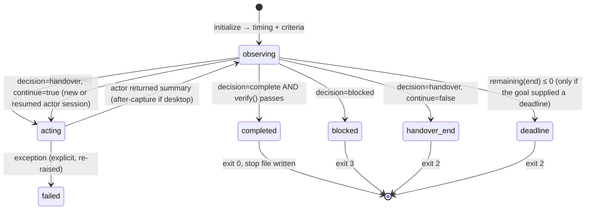

# Trident — forensic audit, living architecture and evolution plan

Audit date: Monday 2026-11-02, 08:28–09:10 (UTC+1, Europe/Warsaw). Workspace `C:\Users\eb-wjt\Downloads\Jarvis\Trident`, branch `runner-h` at `49d69ed` ("Retry Windows file replacement on temporary permission denials"), clean tracked tree (`git diff --stat` empty), 566 physical lines / 40,767 bytes / 8,384 AST nodes / 55 functions / 14 classes in the single application source `main.py`. Only `main.py` and `.gitignore` were tracked; this README is the third tracked file. Everything else in the directory (journals, state, evidence, applications, Cursor session stores, diagnostics) is ignored runtime material and was read in place, unmodified.

This document is written for an agent with no memory of any earlier chat. It contains: what Trident is and how it actually runs, what happened in every recorded run, what the evidence proves and does not prove, the owner's decisions taken on 2026-11-02, and a decisive change plan with exact rules to implement.

---

## 0. Three plain paragraphs

**What happened.** Six runs exist, all from 2026-11-01. Five died within about a minute from a Windows file-replace denial while the controller saved its state. The sixth, after a retry loop was added, ran 22.5 minutes and declared success: five Kraków AI job offers, sourced profile facts, five CV files and a report.

**What would change behavior.** Stop rewriting state files hundreds of times per run (append a narrative instead), let the actor hold the desktop only while it clicks, remove the legacy beat runner, make Jev a first-class tool with a mandatory "change approach" option, and rewrite the prompts so the organism researches, spawns and improves itself by default.

**What to expect.** The job scenario works end to end today, with honest but thin CVs and no GitHub research. After the changes, expect parallel copies, fewer stalls and reusable generated tools; do not expect token or money accounting (Cursor ACP reports none), hiring outcomes, or any guarantee against unintended clicks on live accounts.

---

## 1. Coverage manifest

Legend: READ = read in full; STRUCT = structurally decoded/enumerated; PART = read in part, extent stated; VIEWED = image inspected; OPAQUE = binary not decoded.

| Material | Files | Coverage |
|---|---|---|
| Application source | `main.py` (566 lines), `main.py.before_file_diagnostics.tmp` | READ; diff between them READ (only `write()` lines 237–250 differ) |
| Prompts and tool contracts | `OBSERVER` (l.414), `ACTOR` (l.415), `CONTRACT` (l.416), `DONE` (l.172), `WATCH` (l.74), last sent prompt `prompt.txt` (17,375 B) | READ sentence by sentence |
| Goal and memory | `goal.txt`, `story.txt`, `state.json` (408,895 B) | READ (`state.json` via JSON load: model, sessions, timing, 154 observations census, 23 artifacts) |
| Ledger | `ledger.md` (441,253 B) | STRUCT: 634 headers counted per run and per kind (4+1, 16, 5, 5+1, 32, 569+1); bodies are byte-copies of state/journal events, not re-read |
| Run journals | `run_20261101_145721_9608.md`, `_150045_8840`, `_170419_10172`, `_170808_5860`, `_171035_11584` | READ in full |
| Last run journal | `run_20261101_173529_9512.md` (400,095 B, 181 records) | STRUCT all 181 headers; READ all 7 observer, 7 actor, 6 prompt-start/result and the final record; PART tool records: 60 execute titles, both actor tool-brief lists, the `vacancies.md` edit diff; the other ~120 raw tool records were not read individually |
| Hub journals | `hub_20261101_145608_9024.md`, `hub_20261101_150034_13680.md`, `hub_20261101_173455_1476.md` (425,864 B) | first two READ; third STRUCT (1 `listen` + 148 `run` relays = duplicate of the run journals) |
| Terminal captures | `Windows PowerShell.txt`, `Administrator Windows PowerShell2.txt` | READ (launch commands and tracebacks of runs 1 and 2) |
| Prior agent documents | `COMMIT_MESSAGE.md` (26,844 B), `FILE_PERSISTENCE_DIAGNOSIS.md`, `file_lock_diagnostics.jsonl` | READ; `REVIEW_BRIEF.md` (44,065 B) headers only |
| Deliverables | `applications/vacancies.md`, `profile_facts.md`, `report.md`, `CV_Relativity_Advanced_AI_Engineer.md` | READ; the other four CVs PART (sizes, titles via tool records; not read line by line) |
| Evidence text | `evidence/20261101_173529_9512/*.txt` (page1-3, agile, ig, relativity, unit8, profile, experience*, *-url) | not read; they are clipboard dumps of web pages cited by the deliverables |
| Evidence images | 33 distinct PNG in `evidence/20261101_173529_9512/` | VIEWED, every one, in sequence (§7) |
| Cursor asset copies | `agent/data/projects/.../assets/*.png` (4) | SHA-256 identical to `1-before.png`, `1.png`, `2-before.png`, `2.png`; counted once |
| Cursor CLI config | `agent/config/cli-config.json`, `acp-config.json` (2 B) | READ (model grok-4.7 / 256k / medium / fast; approvalMode allowlist; sandbox disabled; account e-mail present, not reproduced) |
| Cursor sessions | 12 `acp-sessions/<id>/meta.json` READ; 7 `store.db` SQLite (largest 20.5 MB + 5.8 MB WAL) | OPAQUE: not decoded. They hold the full model conversations including Cursor's own system prompt and tool outputs; decoding them is the only way to recover tokens-in-context |
| Statsig caches | 4 × 1,010,547 B | not read (Cursor feature flags) |
| Failed temp files | 9 × `state.json.*.tmp`, 2 × `story.txt.*.tmp` | STRUCT (sizes, times) |
| Credentials | `..\.env` (73 B) | existence and size only; value never read into this report |
| Previous-state archives | `evidence/*/previous.json` (5) | STRUCT (which run inherited which) |
| Git | 30 commits listed; 12 with timestamps | READ |

Missing history: the launch command of run 6 is not captured anywhere (no terminal file; `state.json` shows the default model, so most likely no `--model` flag). No run before 2026-11-01 left runtime records in this workspace. Commits before `7a58a42` describe an earlier `organism.py` design that no longer exists on disk.

---

## 2. What Trident is (architecture meta-description)

Trident is one Python file that turns a single human sentence into finished work on a real Windows desktop. It talks to exactly one model provider surface — the locally installed **Cursor CLI in ACP mode** (`agent.ps1 --trust --workspace <work> acp`, newline-delimited JSON-RPC over stdio) — and uses the model's own native tools (Shell, Read, Edit, Find/Grep, subagents) as the organism's hands. Trident itself contributes: Win32 input/capture helpers, a desktop mutex, a workspace mutex, a Windows job object that kills every child when the run ends, a journal, and two prompted roles.

```mermaid
flowchart LR
  H[Human sentence<br/>--sentence or --mind-file] --> C[main.py run_goal<br/>one process, one workspace lease]
  C -->|JSON-RPC stdio| A[Cursor CLI acp<br/>suspended at start, assigned to job object, resumed]
  A --> O[(Observer session<br/>grok-4.7 medium fast)]
  A --> T[(Actor session<br/>grok-4.7 medium fast)]
  O -->|decision JSON| C
  C -->|action + findings + image| T
  T -->|summary + artifacts| C
  T -->|Shell: python -c import main| W[Win32 helpers<br/>windows focus at pointer chord stroke capture lease]
  T -->|Shell| J[Jev typesafe/jev-1.14<br/>OpenRouter decisions API<br/>key from the parent .env]
  T -->|Shell: python main.py --work copy| C2[Trident copy<br/>own workspace, same desktop mutex]
  T -->|cursor/task| S[Native Cursor subagents]
  C --> M[(Memory on disk<br/>run_*.md journal, state.json, story.txt, ledger.md, evidence/)]
  V[main.py serve<br/>hub on :8765, SSE] -. follows run_*.md .-> M
```

### 2.1 One run, step by step (as the code does it today)

```mermaid
sequenceDiagram
  participant P as main.py
  participant A as Cursor ACP
  participant O as Observer
  participant T as Actor
  P->>P: lease work-<sha256(workspace)> (l.486) · archive old state.json to evidence/<run>/previous.json (l.426)
  P->>A: initialize (l.492) · session/new ×2 · set_config model/reasoning_effort/fast ×3 each · set_mode agent (l.388-391)
  P->>O: OBSERVER+CONTRACT+initial() + {"initialize":true}
  O-->>P: {"timing":{deadline,source},"criteria":[...]} (l.496, validated l.461-471)
  loop until complete / blocked / handover(continue=false)
    P->>O: {now, result, artifacts, desktop, tools} (+ after-image)
    O-->>P: {"decision","action":{instruction,desktop},"findings","handover","message"}
    alt action.desktop == true
      P->>P: lease desktop (wait) · capture <step>-before.png (l.521-523)
    end
    P->>T: {action, findings, message, handover, desktop} (+ before-image)
    T->>T: native tools, Shell → python -c "import main; ..." for input/capture
    T-->>P: {"summary","artifacts"} (l.524)
    P->>P: capture <step>.png · release desktop · stat artifacts (l.527-530)
  end
  P->>P: verify every criterion passed with evidence and reason (l.472-478) · write stop · final record
```

### 2.2 Observer decision state machine



### 2.3 Memory as it exists today

- `run_<id>.md` — append-only journal of every prompt start/result, observer/actor text, completed tool, final record. Human-readable. The only file the hub relays.
- `state.json` — the complete in-memory state, rewritten atomically (temp + `os.replace`) on **every** tool start, tool completion, permission, observation and decision (569 times in run 6).
- `story.txt` — a JSON subset of `state.json` (goal, run, status, checks, action, handover, result, pending_tools), rewritten in step with it. Despite its name it is not a narrative.
- `ledger.md` — append-only copy of every save event with UTC time. 441 KB after six runs.
- `evidence/<run>/` — `previous.json` (archived prior state), controller captures `<step>-before.png` / `<step>.png`, and whatever the actor itself saves there.
- Inheritance into a new run: `Mission.previous` (l.429–431) passes the prior run's goal/run/status/checks/handover/result, interrupted action/sessions/agents/pending_tools and failures into the first prompt of both roles.

### 2.4 Entry points (all three inspected statically)

| Mode | Command shape | Code | Status |
|---|---|---|---|
| Goal run | `main.py --sentence "…" \| --mind-file f [--work dir] [--model slug] [--run id]` | `main()` l.550–562 → `run_goal` l.484 | the living mode |
| Hub viewer | `main.py serve` | `Journal.serve` l.132 → `Live` l.75 | optional; relays `run_*.md` over SSE on 0.0.0.0:8765 and accepts POST `/log` |
| Legacy beats | `main.py beats.txt` (positional file) | `run_beats` l.174, `Desk` l.149, `WATCH` l.74, `DONE` l.172, Jev `decide` l.145 | obsolete; the only user of Jev today; owner decided on 2026-11-02 to delete it |

### 2.5 How to start Trident (owner commands, not reviewer authorization)

```powershell
# goal run in the main workspace; model slug optional (default grok-4.7-medium-fast; BRAINS = grok-4.7-{low,medium,high,xhigh}[-fast])
& 'C:\Users\eb-wjt\AppData\Local\Python\pythoncore-3.11-64\python.exe' -B -u -X utf8 'C:\Users\eb-wjt\Downloads\Jarvis\Trident\main.py' --work 'C:\Users\eb-wjt\Downloads\Jarvis\Trident' --model grok-4.7-xhigh-fast --mind-file 'C:\Users\eb-wjt\Downloads\Jarvis\Trident\task.txt'

# optional viewer in another terminal → http://127.0.0.1:8765/
& 'C:\Users\eb-wjt\AppData\Local\Python\pythoncore-3.11-64\python.exe' -B -u -X utf8 'C:\Users\eb-wjt\Downloads\Jarvis\Trident\main.py' serve

# a same-source copy with its own workspace (what the organism itself should launch when it decides to)
& '<python>' -B -u -X utf8 '<Trident>\main.py' --work '<Trident>\copies\<name>' --model <inherited slug> --sentence '<subgoal>'
```

Exit codes (l.562, 565–566): 0 completed, 2 deadline or ending handover, 3 blocked, 1 unhandled error or Ctrl+C. Prerequisites: Python 3.11, Cursor CLI installed at `%LOCALAPPDATA%\cursor-agent\agent.ps1` and authenticated (`cli-config.json` shows a logged-in account), `..\.env` holding the OpenRouter key for Jev.

---

## 3. Every recorded run (chronology, 2026-11-01, times UTC unless marked local)

| # | Run id (local start) | Goal | Model | Sessions (observer / actor) | What happened | Declared status | Exit |
|---|---|---|---|---|---|---|---|
| 1 | `20261101_145721_9608` (14:57:21 local) | Jobs+CVs, long form incl. "including my github and the fact that i have created Trident system and endgame project … read their code and commit extended messages" | `grok-4.7-xhigh-fast` (terminal capture) | `dc87dec3` / `c05f2e11` (actor never prompted, no store.db) | Observer init 31.39 s, 4 criteria, deadline 14:32:21Z. Second observer prompt started 13:58:08Z; at 13:58:17Z `PermissionError … story.txt.7afd…tmp -> story.txt` inside `save('tool-start')` while `Find` was pending | `failed`, 56.07 s | 1 (traceback in `Windows PowerShell.txt`) |
| 2 | `20261101_150045_8840` (15:00:45 local) | same long goal | `grok-4.7-xhigh-fast` | `21071190` / `79ba7fc4` | Init 19.81 s, 5 criteria (added "main.py was read in full"). Three observer searches completed 14:01:25Z; then `state.json` replace denied in `save('tool-start')`, again in `cancel()`, again in `save('final')` → no final record | none recorded (ledger 16 events, 0 run) | 1 (triple traceback, Administrator terminal) |
| 3 | `20261101_170419_10172` (17:04:19 local) | diagnostic: create/read `hello_diagnostic.txt`, 3-minute deadline | `grok-4.7-xhigh-fast` (per diagnosis doc) | `2101a8cb` / `03cea8a4` | Init 31.09 s; failed ≈53 s on `state.json` during Find; cancel and final save also failed | none recorded | 1 |
| 4 | `20261101_170808_5860` (17:08:08 local) | same diagnostic | `grok-4.7-xhigh-fast` | `a8996ed2` / `e46f962b` | Init 14.23 s; 16:09:04Z `story.txt` denied; Restart Manager found no owner (`file_lock_diagnostics.jsonl:1`) | `failed`, 56.16 s | 1 |
| 5 | `20261101_171035_11584` (17:10:35 local) | diagnostic `hello_diagnostic_second.txt` | `grok-4.7-xhigh-fast` | `0983f944` / `ab5016c4` | Init 14.81 s; 6 observer searches; 16:11:37Z `state.json` denied ×3 with NTSTATUS `0xc0000022` while native `Read state.json` was `in_progress` (`state.json.64a9…tmp`) | none recorded (ledger 32 events) | 1 |
| — | commit `49d69ed` 17:30:17 local | adds 50×10 ms retry around `os.replace` | | | | | |
| 6 | `20261101_173529_9512` (17:35:29 local) | Jobs+CVs, short form (no GitHub/Endgame sentence) | `grok-4.7-medium-fast` (default; `runtime_models` confirm model grok-4.7, context 256k, reasoning medium, fast true) | `2be2a11f` / `d679bf19` | detailed below | `completed`, 1350.2 s, `stop` written 17:57:59 local | 0 (inferred from status; terminal not captured) |

No diagnostic file was ever created by runs 3–5 (their goals), and no vacancy, profile or CV artifact existed before run 6 (observer's own search, run 6 journal l.85: "No vacancy file exists").

### 3.1 Run 6 reconstructed

| UTC | Event | Measured |
|---|---|---|
| 16:35:29.26 | `started_at`; workspace lease; previous state archived (`evidence/…/previous.json`, 7,377 B = run 5's state) | |
| 16:35:40.38 | observer prompt #12 (initialize), 6,795 B text | 13.45 s round trip |
| 16:35:53 | timing: deadline `2026-11-01T17:10:29.259694+00:00`, source "Finish within 35 minutes from this run start."; 6 criteria c1–c6 | |
| 16:35:53.86 | observer prompt #13, 1,422 B; 15 tools (reads of main.py, ledger, previous.json, searches) | 73.42 s |
| 16:37:07 | decision `act`, desktop=true: "place the logged-in Chrome window on the right … search LinkedIn … Do not edit main.py. Do not spawn or await native workers during this action; the desktop mutex stays held until you return." | |
| 16:37:08 | desktop leased; `1-before.png` captured (3,810,121 B: wallpaper + two terminals, no Chrome) | |
| 16:37:08.55 | actor prompt #14, 12,164 B text + image | **828.36 s** (13 min 48 s), 84 tools (execute/read/search/edit), desktop mutex held throughout |
| 16:38:40 | Chrome launched on the right (`--window-position=640,0 --window-size=1280,1000` visible in `2-chrome.png` terminal); LinkedIn autocompleted "Kraków, Łódzkie" (wrong voivodeship) | |
| 16:40:38–16:43:34 | filters, "Remote 2" misfire (1 result, HARMAN Łódź), "Please enter a valid location" after typing `Krak|w` (non-ASCII `ó` not typed by `chord`), then "Krakow" → suggestion "Cracow, Małopolskie, Poland" selected | images 3-*, 4-*, 5-*, 6-* |
| 16:44:00 | 100+ results; ABB Global AI Solution Engineer "4 minutes ago" | `7-cracow.png` |
| 16:45–16:50 | page text copied via Ctrl+A/Ctrl+C → `page1-3.txt`; tighter keyword query → 24 results; Sii, AgileEngine, IG, Unit8, Relativity opened; Unit8 rejected (seat in Lausanne/Zurich) | images 8-*, 9-*, 10-*, 11-* |
| 16:50:48 | `vacancies.md` edited (full diff recorded) | |
| 16:50:56.83 | actor returns summary; `1.png` captured | |
| 16:50:58.15 | observer prompt #15, 48,987 B (includes 84 tool briefs) + `1.png`; 13 tools | 47.64 s |
| 16:51:45 | decision `act`, desktop=true: profile facts, five named CVs, report; "Do not edit main.py. Do not start or await native workers while this desktop action is held." c1 passed | |
| 16:51:46 | `2-before.png` (same Chrome state) | |
| 16:51:47.09 | actor prompt #16, 3,564 B + image | **323.64 s**, 33 tools |
| 16:52:01–16:52:27 | local search for Endgame: only Trident found; `git log -20`; profile page text copied (14,758 B) | |
| 16:53:09 | a click opened LinkedIn **Edit role** form for Ericsson (`profile-exp.png`, Save button visible); Escape closed it, not saved | |
| 16:54–16:55 | experience list read via crops (`exp-list-crop.png`: Ericsson Jan 2017–Present, Ericpol Feb 2014–Dec 2016) | |
| 16:56:12–16:56:58 | `profile_facts.md`, 5 CVs, `report.md` written (7 edits) | |
| 16:57:10.69 | actor returns; `2.png` captured (experience page) | |
| 16:57:12.44 | observer prompt #17, 17,451 B + `2.png`; 9 tools (reads the deliverables) | 47.0 s |
| 16:57:59 | decision `complete`; c2–c4, c6 passed; `verify()` ok; final record; `stop` | elapsed 1350.21 s |

Sum of the six ACP round trips: **1,333.5 s = 98.8 %** of the run. Startup to first prompt 11.1 s. Nothing was spawned: `agents: []`, no `cursor/task`, no copy, no `subagent_spawned`. Zero failed tools. 58 `session/request_permission` requests, all answered `allow_once` by the controller (l.337–340).

### 3.2 Requested vs declared

| Human asked | Delivered | Judgment |
|---|---|---|
| 5 recent open AI-engineering vacancies, 5 companies, Kraków area, each with employer/role/URL/recency/arrangement/requirements | `vacancies.md`: ABB, Sii Poland, AgileEngine, IG Group, Relativity, each with the requested fields, plus a rejected list with reasons | met; URLs are LinkedIn search URLs with `currentJobId` (Sii also has the `/jobs/view/` URL). Recency labels are LinkedIn relative labels, as allowed |
| Research current role, work history and AI projects "using supported sources" | LinkedIn profile + experience page + local Trident git log. GitHub never opened; `endgame-ai` not read ("No Endgame tree was on disk, so that code was not read"); featured posts not verified | partially met; the owner's 2026-11-02 answer: internet research is the default expectation |
| Substantive tailored CV per company | 5 files, 2.7–4.1 KB each; requirement→evidence tables; most rows "Unknown" | honest, not submission-ready: no skills section beyond Trident, no education dates, no achievements; a gap analysis rather than a CV |
| Retain reusable sourced profile facts | `profile_facts.md`, every fact labelled with its URL/path | met |
| Report with links, paths, gaps; no hiring claims | `report.md` | met |
| Read main.py in full; inspect earlier outcomes | observer: "main.py was read through its final line (567)"; previous.json and ledger cited | met (SINGLE-SOURCE: the model's claim; tool titles show reads of main.py) |
| May improve tools/prompts for a demonstrated limitation | nothing edited; observer told the actor "Do not edit main.py" twice | not done; a limitation was demonstrated (see F6) |
| Use native workers and copies when appropriate | none | not done; observer banned them during both actions |

---

## 4. Image inspection log (33 distinct, all viewed)

| Image | Time (local) | What it shows | Role |
|---|---|---|---|
| `1-before.png` | 17:37:08 | wallpaper, two Windows Terminal panes showing the controller's own journal text, no Chrome | controller capture before action 1 |
| `2-chrome.png` | 17:38:40 | Chrome right half; LinkedIn Jobs "AI Engineer in Kraków, Łódzkie, Poland · 200+ results"; ShiftKey Staff AI Engineer, Poland (Remote); left terminal shows window launch args | actor |
| `3-filter.png`, `3-list.png`, `3-top.png` | 17:40 | "Remote 2" filter, 1 result (HARMAN, Łódź); left terminal shows `ConnectionAbortedError [WinError 10053]` (hub SSE client disconnect, SINGLE-SOURCE) | actor + crops |
| `4-loc.png`, `4-wt.png`, `4-wt-crop.png` | 17:41 | location box still "Kraków, Łódz…", workplace popover On-site+Hybrid checked | actor + crops |
| `5-suggest.png`, `5-suggest-crop.png` | 17:42 | location box `Krak|w`, red "Please enter a valid location" | actor + crop |
| `6-krakow.png`, `6-krakow-crop.png` | 17:43 | typed "Krakow"; suggestions incl. "Cracow, Małopolskie, Poland" | actor + crop |
| `7-cracow.png` | 17:44 | Cracow, Małopolskie; 100+ results; ABB Global AI Solution Engineer "4 minutes ago"; Euroclear, Atos cards | actor |
| `8-afterscroll.png`, `8-list.png` | 17:45 | list after scroll with select-all highlight (clipboard copy in progress); Sii GCP Data Engineer, HSBC, Cisco, Verisk | actor + crop |
| `9-tight.png`, `9-top.png`, `9-left.png`, `9-list.png`, `9-right.png` | 17:46–17:47 | Sii Senior AI Engineer job view page `/jobs/view/4483953293/`, Hybrid, 1 day ago, 0 clicked apply; Premium upsell crop | actor + crops |
| `10-back.png`, `10-list.png` | 17:47–17:48 | 24-result list: Sii, AgileEngine, IG Group | actor + crop |
| `11-scroll.png`, `11-list.png` | 17:49 | IG Group pane (reposted 3 days ago, 28 clicked apply); list shows Unit8, Relativity ×2 | actor + crop |
| `1.png` | 17:50:57 | Relativity Advanced AI Engineer pane, Hybrid, reposted 4 days ago, 44 clicked apply; address bar selected | controller capture after action 1 |
| `2-before.png` | 17:51:46 | identical Chrome state to `1.png`, terminal shows observer decision text | controller capture before action 2 |
| `profile-exp.png`, `profile-exp2.png`, `profile-exp2-crop.png`, `profile-dates.png` | 17:53–17:54 | LinkedIn **Edit role** dialog for Ericsson with Save button, fields selected (Ctrl+A), start month January, start year 2017 | actor — unintended form open |
| `exp-list.png`, `exp-list-crop.png` | 17:55 | experience list: Software Engineer Ericsson Jan 2017–Present 9 yrs 11 mos; Software Engineer Ericpol Feb 2014–Dec 2016 | actor + crop |
| `2.png` | 17:57:12 | same experience page | controller capture after action 2 |

Duplicates: the four controller captures also exist byte-identical under `agent/data/projects/C-Users-eb-wjt-Downloads-Jarvis-Trident/assets/` (Cursor stores prompt images). Every actor screenshot includes the left-half terminals showing the controller's journal, so the model sees its own controller output in its eye.

---

## 5. Economics (measured where possible, unknown otherwise)

**Calls.** Run 6: 17 JSON-RPC requests (1 initialize, 2 session/new, 6 set_config_option, 2 set_mode, 6 session/prompt). Model provider calls behind those 6 prompts: unknown (Cursor makes many provider calls per prompt; none are visible over ACP).

**Bytes.** Controller text sent: 6,795 + 1,422 + 12,164 + 48,987 + 3,564 + 17,451 = **90,383 B**. Images sent: 3,810,121 + 1,227,905 + 1,244,164 + 1,211,598 = 7,493,788 B raw PNG, ≈ 9.99 MB base64 on the pipe. Tool outputs flowing into model context: not measured (journal of tool records ≈ 400 KB is a lower bound of what the controller saw, not of what the model saw).

**Tokens.** Unknown. `ACP.update` handles `usage_update` (l.355–356) but the run journal contains zero `usage` records across all six runs. Cursor confirms (forum, 2026-10, below) that `agent acp` emits neither `usage_update` nor `PromptResponse.usage`. The only local store of the full context is the opaque `store.db` SQLite per session.

**Rates (retrieved 2026-11-02).** xAI pricing page (updated 2026-10-10): Grok 4.7 Fast exists only in Cursor and Grok Build, "2x the standard token rates": $4.00 input / $1.00 cached / $12.00 output per 1M tokens below 200k prompt tokens; billed through the Cursor plan. Jev 1.14 on OpenRouter: $0.042 per 1M input tokens, output free, P50 latency 0.13 s, context 262,144, released 2026-10-14. **Charges: unknown; no invoice was available.** Money cannot be computed without token counts.

**Time.** Wall 1,350.2 s. In ACP round trips 1,333.5 s (98.8 %). Of that: observer 181.5 s (13.6 %), actor 1,152.0 s (86.4 %). Desktop mutex held 1,152 s + captures, i.e., the whole actor time, including file writing and page-text parsing that needed no desktop. Startup 11.1 s. Captures ≈1–2 s each ×4. Per tool ≈ 9.8 s mean in action 1 (828 s / 84), ≈ 9.8 s in action 2 (324 s / 33); each `execute` spawned PowerShell → Python → `import main` (which re-runs module-level Win32 setup) — 58 times.

Runs 1–5 each cost one or two observer prompts (14–31 s) and then died; five dead starts ≈ 4.7 minutes of wall time and an unknown number of tokens, producing nothing for the human goal.

---

## 6. Findings (compact structure; evidence classes named)

**F1 — Five runs killed by the controller's own save, not by the task.** OBSERVED: `PermissionError: [WinError 5] Access is denied: '…state.json.63d4…tmp' -> '…state.json'` (Administrator terminal traceback, l.52) and the identical shape for `story.txt` (run 1, `Windows PowerShell.txt` l.52). Corroboration: 9 orphaned `state.json.*.tmp` + 2 `story.txt.*.tmp` on disk (file system), `file_lock_diagnostics.jsonl` NTSTATUS `0xc0000022` (separate instrumentation), journals ending without `final` (runs 2, 3, 5). WHY: every tool start/completion/permission calls `Mission.save` (l.369, 376–377, 340) → `write()` (l.237) → `os.replace(temp, path)`; the model's native Find/Read may hold the destination open at that instant (run 5: `"title": "Read state.json", "status": "in_progress"` in the failed temp). ROOT CAUSE: per-event atomic replacement of files the model is simultaneously reading. The exact Windows blocker (handle share mode or mapping) is unproven (diagnosis doc, Restart Manager found no owner). INFERRED confidence high for the mechanism, moderate for the blocker identity. MAGNITUDE: 5 of 6 runs lost; 569 replacements in run 6. PROPOSED: stop replacing files — append-only narrative + journal (Change 1). AFTER: no `.tmp` files, no retry loop; evidence = absence of PermissionError and `.tmp` files over subsequent runs.

**F2 — The retry loop hides whether the race still happens.** OBSERVED: `for attempt in range(1, 51): … except PermissionError: … time.sleep(0.01)` (l.243–250), no log of attempts. Run 6 succeeded with zero failures recorded. SINGLE-SOURCE for "no race occurred" — indistinguishable from "race occurred and was retried". It is also the kind of automatic retry the owner's standing rules forbid; the owner approved it as a narrow exception on 2026-11-01 and asked on 2026-11-02 for all fallbacks to go. PROPOSED: delete with Change 1.

**F3 — The observer invented bans the human never wrote.** OBSERVED: "Do not edit main.py. Do not spawn or await native workers during this action; the desktop mutex stays held until you return." (run 6 journal l.85, 16:37:07) and again at l.513. The goal said the opposite: "You may improve reusable tools or short prompts … Use useful multistep work, native workers and separate-workspace copies when appropriate." Corroboration: `agents: []`, no `cursor/task` record, no copy (state + journal, same class — the absence of edits to `main.py` is a second class: git shows no change after 17:30). WHY: CONTRACT l.416 "Await children without holding the desktop" + the controller holding the mutex for the entire actor prompt (l.521–526) → the observer correctly inferred that children cannot be awaited during a desktop action and, since both actions were desktop=true, workers were never possible. The "Do not edit main.py" ban has no textual source in the goal or prompts — a model-generated caution (INFERRED, moderate). ROOT CAUSE: the action-level desktop flag plus the "await without desktop" sentence make serialization structural. PROPOSED: Change 2 (actor acquires the desktop itself per interaction) and Change 5 (prompts forbid invented bans). AFTER: desktop held only during clicks; workers and copies allowed in any action.

**F4 — The eye cannot type Polish letters.** OBSERVED: `5-suggest-crop.png` shows `Krak|w` and "Please enter a valid location"; `6-krakow-crop.png` shows the fix by typing ASCII "Krakow". Corroboration: `chord()` (l.38) sends virtual-key codes only; `ó` has no VK; `Desk.paste` uses the clipboard and would have worked. INFERRED (moderate): the actor typed via chords and the diacritic was dropped. MAGNITUDE: ≈1.5 minutes (17:41:39→17:43:26). PROPOSED: the contract states once that `chord` types keys, not text, and that text goes through the clipboard (Change 5).

**F5 — A click opened a live edit form on the owner's LinkedIn profile.** OBSERVED: `profile-exp.png` (Edit role dialog, Save button) — image class; actor summary "A click opened the Ericsson edit form; Escape closed it and Save was not pressed." — text class. WHY: the actor clicked a pencil-adjacent coordinate derived from its own pixel-cluster script (the terminal in `4-wt.png`/`5-suggest.png` shows PIL `getpixel` row clustering) rather than from a visual check. ROOT CAUSE: no cheap, fast target-location step before clicking on a live account. PROPOSED: Jev `box` question before clicks on anything with side effects, with the mandatory "change approach" option (Change 4). AFTER: fewer blind clicks; evidence = Jev box answers recorded next to the click in the journal.

**F6 — The actor built the same ad-hoc tool 58 times and kept none.** OBSERVED: 58 `execute` tool calls, 56 of them `$py = "…python.exe" … -c "import main; …"` variants (state.json census) for focus/click/scroll/clipboard/crop; no edit to `main.py`. Corroboration: git log unchanged after 17:30 local. WHY: CONTRACT l.416 allows improvement but every helper call re-derives the same sequences; the observer forbade edits (F3). ROOT CAUSE: no rule says "when you write the same helper twice, make it generic and keep it in body". MAGNITUDE: each spawn ≈ 1–3 s → tens of seconds of pure process start, and no learning across runs. PROPOSED: Change 6.

**F7 — No token or cost signal exists.** OBSERVED: 0 `usage` records in 6 runs despite handler l.355. Corroboration (external): Cursor forum threads 160395, 165358, 171923 — "the ACP `session/prompt` response only carries `stopReason` today". Not a Trident defect; a provider limit. Unknown remains unknown.

**F8 — Memory is archival, not narrative.** OBSERVED: `story.txt` is `json.dumps({k: state[k] …})` (l.442); `ledger.md` 441 KB of JSON events. Recall did work once: the run 6 observer used `previous.json` to state that earlier runs "never opened Chrome and left no vacancy or CV files" (l.85) — code class (l.429) + behavior class (quote). But nothing tells the next run *how* things were done or what failed and why in words; the owner's design intent is "narrative storytelling as memory". PROPOSED: Change 1 (story.md written by the observer in prose, append-only).

**F9 — The whole desktop is held for the whole action.** OBSERVED: `desktop.enter_context(lease('desktop', mission.end, wait=True))` (l.522) before `client.prompt('actor', …)` (l.524); actor prompt lasted 828 s. Corroboration: `2-chrome.png`–`11-list.png` show long stretches of clipboard parsing and file edits during which no input was sent. ROOT CAUSE: the desktop flag is per action, not per interaction. PROPOSED: Change 2.

**F10 — Location autocomplete misfire corrected by the organism (success).** OBSERVED: `2-chrome.png` "Kraków, Łódzkie" (200+ results, remote Poland offers) → `7-cracow.png` "Cracow, Małopolskie" (geoId=103263110). Corroboration: `vacancies.md` records the geoId and rejects HARMAN Łódź with the reason "It appeared before the location was set to Cracow". Effective adaptation; no change needed except making it cheaper (Jev `noul`: "Is the location filter Cracow, Małopolskie?").

**F11 — Criteria absorbed procedure and timing.** OBSERVED: c5 "main.py is read in full …", c6 "The work finishes within 35 minutes of …" (l.11). The code requires criteria to pass with evidence (l.472–478), so procedural clauses become things to prove rather than things to do. WHY: OBSERVER l.414 "criteria":["acceptance condition"] gives no distinction between result and process. PROPOSED: Change 5 (criteria are about the result the human will hold; timing is controller arithmetic only when the human wrote it).

**F12 — Source-only risks (no incident observed).** (a) `Live.do_POST /log` accepts unauthenticated JSON on 0.0.0.0:8765 (l.78–81) — only the beats runner uses it. (b) `decide()` reads the OpenRouter key from `ROOT.parent/.env` (l.146) — a copy with `--work` elsewhere still finds it via `ROOT`, fine; a clone elsewhere will not. (c) `prompt()` raises on any `stopReason != end_turn` (l.406) — a `cancelled`/`max_turn_requests` ends the run explicitly; correct per the rules, but worth knowing. (d) The hub's SSE handler raises `ConnectionAbortedError` on client disconnect (seen in `3-filter.png` terminal) — explicit, harmless.

---

## 7. Prompt and contract review (sentence by sentence, current text l.414–416)

OBSERVER: "The human goal is the assignment." ✓. "First return only {timing, criteria} … interpreting timing from the goal without tools" ✓ but produced procedural criteria (F11). "Findings update only changed criteria" ✓ followed. "Decisions are act, complete, blocked, or handover" ✓. "Desktop input is coordinated through actor actions; your own tools can research, inspect and improve files." — the observer never improved anything and told the actor not to (F3).

ACTOR: "Perform useful multistep work … observing results between dependent operations" ✓ (84 tools in one turn). "Inspect fresh images and actual interface bounds for desktop input" ✓ partially (crops; still one blind click, F5). "Report real worker/process IDs and paths" ✓ ("No native workers were started" is truthful). "closing this run ends its process job" ✓ true (job object l.264–265 `KILL_ON_JOB_CLOSE`).

CONTRACT: "Both contexts and native workers have the installed task tools and the owner's standing authorization" ✓. "Use genuine native workers for independent work" — contradicted in practice by "Await children without holding the desktop" + structural desktop holding (F3/F9): a contradiction between promise and mechanism. "Full copies use the supplied Python and body with --sentence, --model and a separate --work" ✓ accurate. "Desktop=true holds the shared desktop mutex for the action" — accurate and the problem. "State, story, ledger, goal, prompt and stop are controller memory" — stale after Change 1. Helper signatures: accurate for `windows/focus/at/pointer/chord/stroke/screen_area/capture`; missing: text input needs the clipboard; `lease('desktop')` is available to the actor but not mentioned; Jev is not mentioned at all. "SendInput insertion does not establish application effect" ✓ good epistemics. No scarcity/urgency language in the prompts; urgency came only from the human's "35 minutes" and was correctly scoped. Cognitive load: the first prompt is ≈6.8 KB of JSON incl. `initial()`; the third observer prompt was 49 KB mostly tool briefs — the brief list is the largest avoidable load.

---

## 8. Five perspectives

**Systems/runtime.** Process tree is sound: Cursor CLI started suspended, assigned to a kill-on-close job, resumed (l.299–306); copies launched through its Shell inherit the job. Workspace lease prevents two runs on one workspace (l.486). Deadline arithmetic is monotonic and only exists if the human wrote one (l.461–467). Stream framing: newline JSON, one reader thread per pipe, pumped into a queue (l.313–316). The one real defect is the save path (F1/F2). Image coordinates: captures are whole virtual screen with origin and size recorded (l.455–458); `screen_area` maps shown-image pixels back to physical pixels — correct for the model's possibly rescaled view.

**Prompt engineering.** The contract is honest and compact. Its two faults: it promises parallel workers while the mechanism serializes everything (F3/F9), and it says nothing about Jev, text input, or when to generate a reusable tool. Criteria design lets procedure leak into acceptance (F11). Proposed texts in §11.

**Behavioral.** Established from quotes: effective adaptation (F10), truthful reporting of the unintended form (F5) and of unknowns (CVs list "Unknown" rather than inventing), no confabulated progress found (every declared artifact exists: 23 artifact stats recorded, all files present). Not established: rumination or helplessness — the long actor turn was continuous productive tool use (84 tools, ≈10 s each). Over-caution is established: two invented bans (F3). Tunnel vision is weakly indicated: 56 near-identical Python one-liners instead of one generic helper (F6).

**Economics.** 98.8 % of wall time is model turns; the actor dominates. Five dead starts wasted ≈4.7 min and unknown tokens. Money is unknown (F7). The cheapest lever is not fewer model calls but fewer process spawns and a cheaper eye: Jev at $0.042/M input vs Grok 4.7 Fast at $4/M input (image tokens on Grok are unknown per image; on Jev also unknown but the per-token price is ≈95× lower).

**Evolution/memory.** What was stored: everything, as JSON. What was recalled: the prior runs' failure facts (worked). What was learned and kept: nothing — no tool, no prompt, no narrative. Misgeneralization risk: none observed (no job-specific rule entered the controller). Reproduction: never attempted. The organism currently remembers *that* and not *how*.

---

## 9. Owner decisions taken on 2026-11-02 (binding for the next agent)

1. Internet research and access are the default expectation in every goal; the current date and the latest facts must be gathered from the internet, not assumed. This is task-agnostic, not about GitHub or Endgame specifically.
2. **No fallbacks, no defensive coding, no legacy features.** Remove the beats mode and anything only it uses. Remove the retry loop. Failures stay explicit.
3. The code self-modifies, and only `main.py`. Every run is a fresh execution of `main.py`, so any edit applies to the next run; the organism must understand this plainly ("the body you edit is the body of your next run") and must not reason about hot reloading.
4. Topology is not static. The organism decides how many Trident copies and how many native Cursor subagents to spawn, for what, and when. Bare metal simple.
5. Evolution rule: when the organism discovers it needs a tool, it generates that tool **generically and task-agnostically** into `main.py` so the next task has it.
6. Jev is a tool from Trident's perspective, used a lot because it is cheap: typed `choice`/`noul`/`score` questions over text and `box` over PNG screenshots. Every `choice` question includes a **"change approach"** option so Jev can break tunnel vision. If Jev fails (e.g., unpaid balance) the error is shown to the model, which does the work another way; **no code branch** implements that.
7. No default deadline. Timing exists only when the human writes it.
8. Prompts and tool descriptions are rewritten so the organism exists as a living meta: proactive, autonomous, task-agnostic, researching and spawning by default, without wording that triggers provider refusals.

---

## 10. The ten changes (what happened last time → change → how it plays after)

Each item is a proposal for the next implementing agent. "After" statements are **unmeasured predictions** with stated confidence. Line numbers refer to `49d69ed`.

| # | Change | Last time (evidence) | Exact edit | After (predicted) | Confidence |
|---|---|---|---|---|---|
| 1 | **Append-only memory; delete `write()` and its retry** | 5 runs died in `os.replace` (F1); run 6 replaced files 569 times; `story.txt` is JSON (F8) | Delete `write()` l.237–250 and `Mission.save` triple-write l.440–444. Keep `record()` (append). Keep `state` in memory. On each observer decision append the observer's `message` as prose to `story.md` (one paragraph: what was tried, seen, learned, next). On final, append the final record to `story.md` and the journal. `goal.txt`, `prompt.txt`, `stop`: write with plain `Path.write_text` (no temp/replace) or drop `prompt.txt`. Delete `ledger.md` writing. `previous.json` becomes the last 20 paragraphs of `story.md` passed into `initial()` | No `.tmp` files; no PermissionError path exists; the next run reads a story, not a dump | high that the crash class disappears (append never needs replace); medium that prose recall beats JSON recall |
| 2 | **Actor holds the desktop per interaction, not per action** | mutex held 828 s and 324 s while parsing text and writing files (F9); workers banned (F3) | Delete the controller lease l.521–523 and the `desktop` boolean in the action schema (OBSERVER l.414). Keep `capture()` before/after actor turns for the journal. Contract: "wrap each burst of input in `with lease('desktop', wait=True): …` inside your Shell snippet; capture after acquiring; release when the burst ends" | Copies and subagents can click between the actor's bursts; the shared desktop stays cooperative through the existing mutex | high (mechanism exists: `lease` l.223) |
| 3 | **Delete beats mode and its private plumbing** | never used since 2026-10-30 commits; the only Jev user (l.172–186) | Delete `WATCH` l.74, `Desk` l.149–171, `DONE` l.172–173, `run_beats` l.174–186, `log()` l.143–144, `Live.do_POST` l.78–81, `main()` l.553. Keep `request`, `decide`, the hub GET routes | ≈45 fewer physical lines; one entry path plus the viewer | high |
| 4 | **Jev as a declared tool with mandatory "change approach"** | Jev unused in goal runs; one blind click opened a live edit form (F5) | Keep `decide(state, questions)` l.145–148. Contract adds: "`decide(state, questions)` asks Jev (typesafe/jev-1.14): `choice` {criteria: option→description}, `noul` yes/no with criteria true/false, `score` ordered levels, `box` locate a described target in a PNG part `{"type":"image_url","image_url":{"url":"data:image/png;base64,…"}}` placed in `state`; returns `answers` with probabilities. Every `choice` must contain the option `change approach`. Use it before side-effect clicks, to verify screens, to pick among routes, and to check your own criteria. If it raises, read the error and continue your own way." Optionally a 2-line `box(image_path, description)` helper that builds the request | Cheap, fast checks replace some Grok image turns; tunnel vision gets an explicit exit each time | medium (behavioral; depends on the model using it) |
| 5 | **Rewrite OBSERVER/ACTOR/CONTRACT** (texts in §11) | invented bans (F3), procedural criteria (F11), diacritics (F4), no research default | Replace l.414–416 with §11 texts | Criteria describe the deliverable; research is default; no invented restrictions; text via clipboard | medium-high |
| 6 | **Tool genesis rule** | 56 near-identical one-liners, nothing kept (F6) | Contract sentence: "When you write the same helper twice, add it to body as one generic function with real arguments and return values, no task words, and use it from then on; say what you added." Controller: at `final`, if `main.py` changed during the run (compare mtime or sha256 at start vs end), journal "body changed" with the diff summary | Each run leaves at least the tools it needed; next runs import them | medium |
| 7 | **Organism-decided topology** | no copies, no subagents (F3) | Contract: "Spawn native subagents (independent reads/research/writing) or full Trident copies (`<python> main.py --work <new dir> --model <your model> --sentence …`) whenever work is independent; you decide how many; record their IDs and collect results before you finish; copies share the desktop mutex and the account." Delete the sentence "Await children without holding the desktop" (moot after Change 2) | Parallel CVs/research; the parent waits only on results | medium (never observed yet) |
| 8 | **Smaller observer prompts** | 48,987 B prompt mostly tool briefs | In the `update` dict l.532–533 send `tools` as counts per kind plus the `locations` list, not every brief; the full briefs remain in the journal the observer can Read | Shorter observer turns; same information available on demand | medium; unmeasured bytes |
| 9 | **Process-spawn thrift** | 58 `python -c "import main; …"` spawns | Contract: "Batch several helper calls in one Python invocation; one capture per burst" | Fewer seconds lost to interpreter start | low-medium (behavioral) |
| 10 | **Goal template and launch** | run 6 goal mixed authorization, task, procedure and timing in one paragraph | Owner writes goals with the template in §12; the controller stays unchanged (the sentence is the only assignment) | Clearer criteria; research/spawning expected without per-goal reminders | high for clarity; outcome unmeasured |

LOC accounting for the plan (estimate, to be measured by the implementer): −45 (Change 3) −14 (`write`) −5 (`save`) −3 (lease in loop) ≈ −67 physical lines; +≈12 lines of contract text (data) +≈6 lines (`story.md` append, body-changed check, optional `box` helper). Net ≈ −50 lines, AST node count expected to fall proportionally. Capability preserved: protocol parsing, job lifetime, mutexes, deadline arithmetic when the human sets one, captures, helpers, Jev. Capability removed: beats runner, hub POST.

---

## 11. Proposed prompt texts (data; replace l.414–416)

OBSERVER
> You are Trident's observer, the organism's judgment. The human sentence is the only assignment; today's date and current facts come from the system clock and the internet, never from memory. First return only {"timing":{"deadline":null,"source":null},"criteria":["…"]}: a deadline exists only if the human wrote one (ISO with timezone, source quoted verbatim); criteria describe the result the human will hold, never procedure or timing. Then, each turn, inspect real evidence with your tools and return {"decision":"act|complete|blocked|handover","action":{"instruction":"…"},"findings":{"c1":{"passed":false,"evidence":["path"],"reason":"…"}},"handover":null,"message":"…"}. Your message is the organism's memory: write in plain prose what was tried, what was seen, what was learned and what comes next; it is appended to story.md and read by future runs. Add no restriction the human did not write. Complete only when every criterion is supported by inspected artifacts. Handover {"continue":true,"session_id":null|actor id,"instructions":"…"} resumes or refreshes the actor.

ACTOR
> You are Trident's actor, the organism's hands and eyes. Do useful multistep work toward the current action, observing results between dependent steps; research the internet by default; spawn native subagents or Trident copies whenever work is independent and decide their number yourself; hold the desktop only while you send input. Return {"summary":"what actually happened, including failures, unfinished work, workers and copies with their real IDs","artifacts":["existing paths"],"body_changes":["what you added to main.py and why, or empty"]}.

CONTRACT
> One JSON object, no Markdown. You have the installed tools of this computer and the owner's standing authorization for research, files, applications, Chrome, images, shell and code. Body is `<path to main.py>`: the body you edit is the body of your next run; edit it when a limitation is demonstrated and when you write the same helper twice, as one generic function with real arguments, return values and raised errors, no task words. Helpers (import main): windows(title_suffix)->HWNDs; focus(hwnd); at(hwnd,x,y)->screen px; pointer(x,y,flags 0 move/2 down/4 up) screen px; chord(*(vk,0 down/2 up)) types keys not text — text goes through the clipboard then Ctrl+V; stroke(hwnd,points,pause); screen_area(desktop,x,y,w,h,shown_w,shown_h); capture(path)->whole-desktop PNG; lease('desktop',wait=True) context manager — acquire for each burst of input, capture after acquiring, release after; decide(state,questions)->Jev typesafe/jev-1.14 typed answers: choice/noul/score over text, box over a PNG image part in state; every choice includes the option "change approach"; use Jev before side-effect clicks and to verify screens and criteria; if it raises, read the error and proceed your own way. Copies: `<python> <body> --work <new dir> --model <your model> --sentence <subgoal>`; they own their workspace, share the desktop mutex and the account, and die with this run's job unless started detached; collect their results before finishing. Memory: story.md (prose, append-only), run_*.md (journal), evidence/<run>/ (captures). SendInput does not prove application effect; inspect.

Wording deliberately avoids "bypass", "ignore safety", "any means" and similar phrases that trigger provider refusals; it states ownership, authorization and purpose instead.

---

## 12. Goal template (prefix · [GOAL] · postfix)

```
I am <owner name>, the owner of this computer and of the accounts logged in on it. Today's date and all current facts must be taken from the system clock and the internet. Use everything installed here — shell, files, Chrome, the screen, the clipboard, Jev, native subagents and Trident copies — and decide yourself how to split the work.

[GOAL]

Judge the real result against this sentence, not against effort. Report what exists with paths and source links, what was verified and how, and what remains unknown or unfinished. Make no success claim without inspected evidence. If you built a generic tool on the way, keep it in main.py and say so.
```

Add a timing sentence only when it is real: "Finish within N minutes from this run start." Add owner-specific permissions in the prefix (e.g., "You may read my public GitHub and LinkedIn") only when they are not already general.

---

## 13. Timelines

Current (measured, run 6):

```mermaid
gantt
  title Run 20261101_173529_9512 — measured (UTC)
  dateFormat HH:mm:ss
  axisFormat %H:%M
  section Controller
  startup and sessions          :16:35:29, 16:35:40
  section Observer
  init 13.5 s                   :16:35:40, 16:35:53
  decide 1 73.4 s 15 tools      :16:35:53, 16:37:07
  decide 2 47.6 s 13 tools      :16:50:58, 16:51:45
  decide 3 complete 47.0 s      :16:57:12, 16:57:59
  section Actor (desktop held)
  action 1 jobs 828 s 84 tools  :16:37:08, 16:50:56
  action 2 profile CVs 324 s    :16:51:47, 16:57:10
```



Proposed (prediction, unmeasured; same scenario, Changes 1–7 applied):

```mermaid
gantt
  title Same goal after the plan — predicted shape, not measured
  dateFormat HH:mm:ss
  axisFormat %H:%M
  section Observer
  criteria                       :00:00:10, 00:00:25
  judge and narrate              :00:12:00, 00:12:45
  section Actor
  browse offers, desktop per burst :00:00:30, 00:08:00
  profile and GitHub research      :00:08:00, 00:11:30
  section Copies and subagents
  copy A CV x2                     :00:03:00, 00:09:00
  copy B CV x3                     :00:03:00, 00:09:30
  subagent report and facts        :00:09:30, 00:11:30
  section Jev
  box and noul checks 0.13 s each  :00:00:30, 00:11:30
```



The predicted shape depends on the model actually spawning work; nothing in the plan forces it, by design.

---

## 14. Implementation brief for the next agent (decisive, minimal)

1. Read this README and `main.py` in full. Confirm `HEAD` is `49d69ed` on `runner-h`; if not, diff first and keep others' edits.
2. Apply Changes 3, 1, 2, 5, 4, 6, 7, 8 in that order, editing only `main.py`. No comments, no docstrings, no new files, no dependencies. Keep every helper signature named in the contract accurate.
3. Static checks only: `python -c "import ast,sys;ast.parse(open('main.py',encoding='utf-8').read())"`, tokenizer pass, `git diff --stat`, physical line count and AST node count before/after. Do not launch Trident, the hub, or a paid goal.
4. Commit only `main.py` with a message that states lines removed/added, what was deleted, what capability remains, and what is unverified. Push to `origin/runner-h`. Never force-push.
5. Leave runtime files, `.env`, evidence and `applications/` untouched.
6. The first owner-run after the change is the measurement: expect no `.tmp` files, a `story.md` with prose paragraphs, Jev calls in the journal, and worker/copy IDs in actor summaries. Compare against §5 numbers.

---

## 15. External research notes (retrieved 2026-11-02)

- Cursor ACP: [cursor.com/docs/cli/acp](https://cursor.com/docs/cli/acp) — `agent acp`, stdio JSON-RPC, `session/new|load|prompt|cancel`, `session/request_permission` with `allow-once`. Matches `ACP` class behavior.
- Token usage over ACP: [forum 160395](https://forum.cursor.com/t/cursor-acp-doesn-t-seem-to-return-token-usage-in-promptresponse-usage/160395), [forum 165358](https://forum.cursor.com/t/cli-emit-acp-usage-update-so-clients-like-zed-can-show-a-context-window-indicator/165358), [forum 171923](https://forum.cursor.com/t/cursor-agent-acp-never-reports-token-usage-over-acp-though-p-output-format-json-does/171923) — Cursor staff: "the ACP `session/prompt` response only carries `stopReason` today". Consistent with zero `usage` records locally (F7).
- Grok 4.7 pricing: [docs.x.ai/developers/pricing](https://docs.x.ai/developers/pricing) (updated 2026-10-10): standard $2/$0.50/$6 per 1M; Fast variant Cursor/Grok Build only at $4/$1/$12 (<200k prompt). Knowledge cutoff May 2026 ([developer guide](https://docs.x.ai/developers/grok-4-7)). Cursor bills the fast variant through the plan; no local invoice.
- Jev: [openrouter.ai/docs/guides/community/jev](https://openrouter.ai/docs/guides/community/jev), [openrouter.ai/typesafe/jev-1.14](https://openrouter.ai/typesafe/jev-1.14) — $0.042/M input, output free, 262k context, P50 0.13 s, released 2026-10-14; primitives choice/noul/score/box; images as base64 PNG/JPEG parts in `state` ([multimodal decisions](https://openrouter.ai/docs/guides/community/multimodal-decisions)). The existing `decide()` already targets `POST https://openrouter.ai/api/alpha/decisions` with `{"model","state","questions"}` and reads `answers` — the correct surface. Product capability does not prove local access: the key in `..\.env` and its balance were not tested (no paid calls in this audit).

---

## 16. Limits of this audit

- Tool records of run 6 were read structurally and selectively (§1); every decision, summary and prompt metric was read in full.
- `store.db` session stores were not decoded; the model's full context, Cursor's system prompt and provider call counts remain unknown.
- No execution of any kind was performed; all "after" statements are predictions.
- The run 6 launch command and exit code were inferred from `state.json` (`model` = default) and `stop` file time, not observed.
- The Windows blocker behind `WinError 5` remains unidentified; Change 1 removes the operation rather than diagnosing the blocker.
- CV quality was judged from one CV read in full and the observer's descriptions of the other four.
