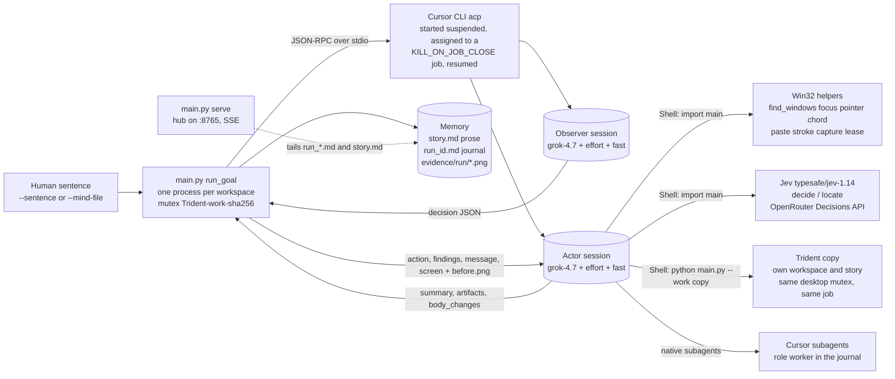
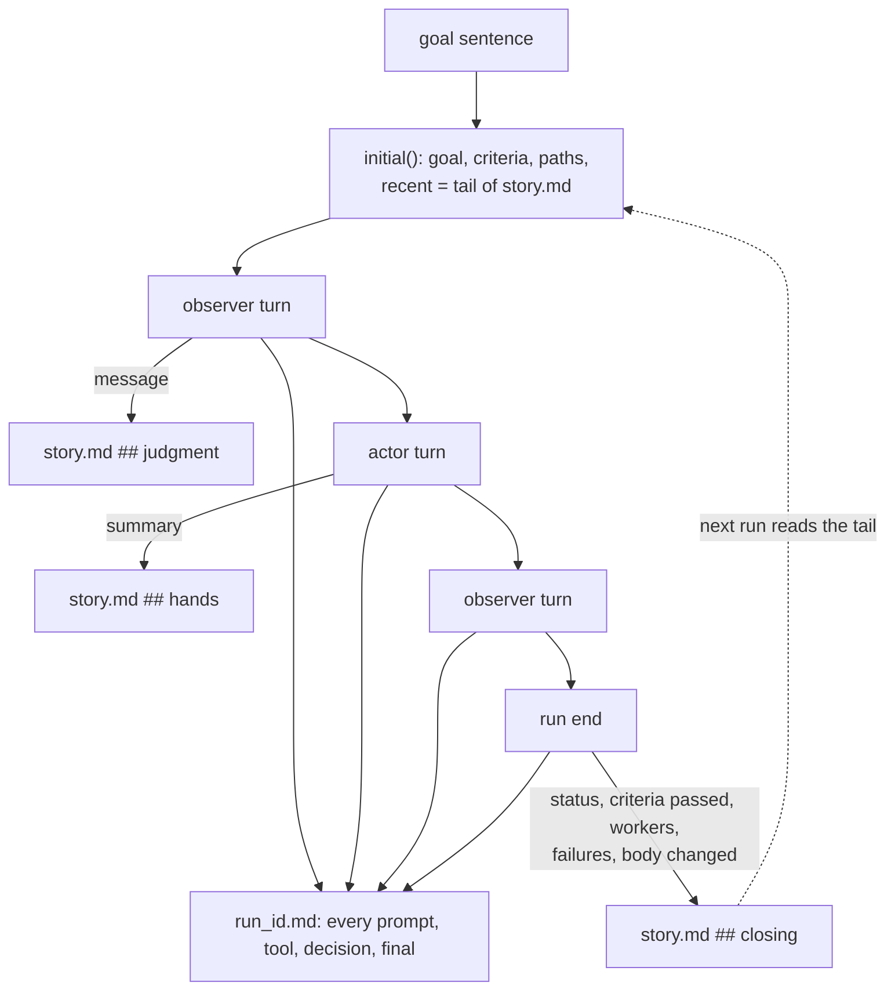
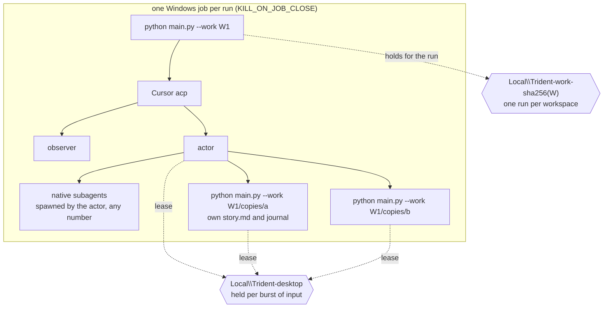

# Trident — a living organism for any computer task

Body: `main.py`, 484 lines, one file, branch `runner-h`. Written 2026-11-02 as a from-scratch rewrite of the body that ran the 2026-11-01 job-search goal (tag `trident-jobs-cv-2026-11-01`, commit `49d69ed`). This README describes the new body as the code defines it. The new body has not been launched yet; every statement about its behavior is derived from the source, and every measured number comes from the previous body's recorded runs, which are kept in §14 as lineage.

---

## 0. Three plain paragraphs

**What it is.** One Python file turns one human sentence into finished work on a real Windows computer. It hires the locally installed Cursor agent as its mind, Jev as its fast judgment, Windows itself as its hands and eyes, and keeps a diary in prose so the next run remembers what happened.

**How it works.** An observer reads the sentence, writes the acceptance criteria, judges evidence and narrates. An actor does the work with every installed tool, spawns helpers and copies when work is independent, holds the desktop only while it clicks, and may edit the body itself. The edit is live on the next run.

**What to expect.** Honest results judged on inspected artifacts, no invented deadlines or bans, cheap Jev checks before risky clicks, and a growing `story.md`. Not to expect: token or money accounting (Cursor's ACP reports none), guarantees against side effects on live accounts, or any run that has been verified before you launch one.

---

## 1. Orientation for an agent with no memory

Read in this order, completely, before judging anything:

1. This file, end to end.
2. `main.py`, end to end (484 lines; §4 maps the sections).
3. `story.md` at the workspace root: the organism's own prose memory across runs, newest at the bottom.
4. Every `run_*.md` journal, oldest first, including runs that did not finish.
5. Every image under `evidence/<run>/`, in file order, deduplicating by content hash.
6. `goal.txt`, `stop` (its presence means the last run declared completion), `agent/config/cli-config.json` (model and account), `agent/config/acp-sessions/*/meta.json` (which Cursor sessions existed; `store.db` are opaque SQLite stores).
7. `git log --oneline --decorate`, the tag `trident-jobs-cv-2026-11-01`, and commit `85ddd69` for the full forensic audit of the previous body.

Then follow §16 to audit what you read.

---

## 2. Principles the code embodies

- **One sentence is the assignment.** No planner, router or task taxonomy. `--sentence` or `--mind-file` is the whole input.
- **One file is the body.** Only `main.py` is tracked; `.gitignore` ignores everything else. Runtime files are memory, not code.
- **One model surface.** The Cursor CLI in ACP mode (`agent.ps1 acp`), newline-delimited JSON-RPC over stdio. The model's own tools — Shell, Read, Edit, Find/Grep, subagents — are the organism's hands.
- **Memory is a story.** `story.md` is append-only prose; nothing is ever rewritten or replaced on disk, so the file race that killed five runs of the previous body has no code path.
- **Jev is the fast judgment.** `typesafe/jev-1.14` answers typed questions (`choice`, `noul`, `score`, `box`) over text and screenshots at $0.042 per million input tokens. Every choice question carries the option `change approach`, injected by code, so the organism always has an exit from tunnel vision.
- **The desktop is shared cooperatively.** A named Windows mutex, held by whoever sends input, for exactly as long as the burst of input lasts.
- **Topology is the organism's decision.** Native Cursor subagents and full Trident copies (`main.py --work <other dir>`) are spawned by the actor when work is independent; nothing in the code fixes their number.
- **The body you edit is the body of your next run.** Every run is a fresh execution of `main.py`; the contract says so plainly and the run end narrates whether the body's SHA-256 changed.
- **No fallbacks, no retries, no defensive layers.** Unexpected failures raise; expected terminations (deadline, blocked) are explicit states with exit codes.
- **A deadline exists only when the human wrote one.** The observer must quote it verbatim from the goal and give an ISO timestamp with timezone; otherwise `end` stays `None` and nothing counts down.

---

## 3. Architecture



Process tree at run time: `python main.py` → `powershell.exe agent.ps1 … acp` → Cursor's node process → any Shell the model runs → `python -c "import main; …"` helpers, `powershell.exe` captures, and Trident copies. Everything below `python main.py` belongs to one Windows job object with `JOB_OBJECT_LIMIT_KILL_ON_JOB_CLOSE`; when the run's `ExitStack` closes, the job handle closes and the whole tree ends (`job_object`, lines 141–147; registration order in `ACP.__init__`, lines 252–264).

---

## 4. Anatomy of `main.py`

| Lines | Section | What it holds |
|---|---|---|
| 1–15 | constants | `BODY`, `ROOT`, `HUB_PORT=8765`, `JEV='typesafe/jev-1.14'`, `DECISIONS` URL, `GROK='grok-4.7'`, the eight `MINDS` slugs `grok-4.7-{low,medium,high,xhigh}[-fast]`, default `MIND='grok-4.7-medium-fast'`, process flags, hub palette |
| 16–41 | Win32 bindings | `signature()` declares restype/argtypes for 19 user32/kernel32/ntdll functions; `SetProcessDPIAware()` so every metric is physical pixels |
| 42–55 | structures | `MOUSEINPUT`, `KEYBDINPUT`, `INPUT` (anonymous union, 40 bytes on x64), `JOBOBJECT_BASIC/EXTENDED_LIMIT_INFORMATION` (144 bytes) |
| 56–67 | control | `Deadline`, `Blocked`; `check()` raises `WinError` on a false result; `utc()`; `remaining(end)` raises `Deadline` at zero and returns `None` when there is no deadline |
| 68–110 | hands | `virtual_screen()`, `send()`, `pointer(x,y,flags)`, `chord(*(vk,updown))`, `focus(hwnd)`, `find_windows(suffix)`, `client_size(hwnd)`, `to_screen(hwnd,x,y)`, `stroke(hwnd,points,pause)` |
| 111–127 | eye and text | `powershell(script,end)`; `capture(path,end,region)` whole virtual screen or a physical region as PNG; `paste(hwnd,text)` clipboard via base64 then Ctrl+V |
| 128–147 | cooperation and lifetime | `lease(name,end,wait)` named-mutex context manager; `job_object(resources)` |
| 148–164 | Jev | `post()`, `image_part(path)`, `png_size(path)`, `decide(state,questions)` (adds `change approach` to every choice), `locate(image,description,left,top)` |
| 165–172 | memory and mind | `journal(path,text)` append + stdout; `choose_mind(goal,model)` |
| 173–192 | prompts as data | `OBSERVER` (1,540 chars), `ACTOR` (837), `CONTRACT` (2,511) — verbatim in §11 |
| 193–241 | `Mission` | run identity, files, in-memory `state`, `record`, `narrate`, `artifact`, `observe`, `initialize`, `verify`, `initial` |
| 242–363 | `ACP` | Cursor process start, pumps, `rpc`, `notice`, `update`, `session`, `prompt`, `cancel` |
| 364–423 | `run_goal` | the loop (§5) and the closing narration |
| 424–470 | hub | `PAGE`, `Hub` handler (GET `/`, `/events`, `/md`), `Feed` (tails `run_*.md` and `story.md`), `FeedServer` |
| 471–484 | `main` | `serve` or a goal run; exit codes |

Structural metrics at commit `9ca06de`: 484 physical lines, 37,589 bytes, 7,209 AST nodes, 52 functions, 13 classes, 0 comments, 0 docstrings.

---

## 5. One run, step by step

```mermaid
sequenceDiagram
  participant P as main.py
  participant A as Cursor ACP
  participant O as Observer
  participant T as Actor
  P->>P: lease work-sha256(workspace) · Mission: run id, run_<id>.md, story.md touch, evidence/<id>/, goal.txt, stop removed
  P->>P: sha256 of the body (before)
  P->>A: start agent.ps1 acp suspended · assign to job · resume · initialize (id 1)
  P->>A: session/new actor (2) · set_config model, reasoning_effort, fast (3-5) · set_mode agent (6)
  P->>A: session/new observer (7) · set_config x3 (8-10) · set_mode agent (11)
  P->>O: OBSERVER + CONTRACT + initial() + {"initialize":true} (12)
  O-->>P: {"timing":{deadline,source},"criteria":[...]}
  P->>P: validate timing (quote must be in goal, tz required) · number criteria c1..cN
  P->>P: capture evidence/<id>/0.png
  loop until complete, blocked or handover(continue=false)
    P->>O: {now, criteria|result, timing|artifacts, screen, tools} + latest capture
    O-->>P: {"decision","action":{"instruction"},"findings","handover","message"}
    P->>P: narrate judgment → story.md
    alt act (or handover with continue=true, after resuming or refreshing the actor session)
      P->>P: capture <step>-before.png
      P->>T: {action, findings, message, handover, screen} + before.png
      T->>T: tools; lease('desktop') per input burst; decide/locate; subagents; copies; maybe edits the body
      T-->>P: {"summary","artifacts","body_changes"}
      P->>P: narrate hands → story.md · capture <step>.png · stat artifacts
    end
  end
  P->>P: complete → verify(): every criterion passed with reason and existing evidence, no pending tools
  P->>P: finally: sha256 of the body (after) · narrate closing → story.md · record final · stop if completed
```

Observer decisions and their effect (`run_goal`, lines 380–395):

```mermaid
stateDiagram-v2
  [*] --> observing: initialize → timing + criteria
  observing --> acting: act
  observing --> acting: handover, continue=true (resume recorded actor or fresh)
  acting --> observing: actor returned summary; after capture taken
  observing --> completed: complete and verify() passes
  observing --> blocked: blocked
  observing --> handover: handover, continue=false
  observing --> deadline: remaining(end) reaches zero (only if the goal set one)
  acting --> failed: any unexpected exception, re-raised
  completed --> [*]: exit 0, stop written
  blocked --> [*]: exit 3
  handover --> [*]: exit 2
  deadline --> [*]: exit 2
```



What each role receives (`ACP.prompt`, lines 343–358):

- First prompt of a session: `ROLE + "\n" + CONTRACT + "\n" + JSON(initial()) + "\n" + JSON(update)`. `initial()` carries `goal, model, started, timing, criteria, sessions, now, python, body, work, memory{story, journal, evidence}, recent` where `recent` is the last 8,000 characters of `story.md`.
- Observer updates: first `{now, criteria, timing, screen}`, then `{now, result, artifacts, screen, tools}` where `tools` is the compact list of the actor's completed tools (role, kind, title, status, locations). The image attached is the newest capture.
- Actor updates: `{action, findings, message, handover, screen}` with `<step>-before.png` attached.
- The model's reply must be one JSON object; anything else fails `json.loads` and ends the run explicitly. A stop reason other than `end_turn` ends the run explicitly.

---

## 6. Memory

| File | Written by | Form | Purpose |
|---|---|---|---|
| `story.md` (workspace root) | `Mission.narrate` | append-only; `## <UTC> <run> <voice>` then a prose paragraph; voices `judgment` (observer message), `hands` (actor summary), `closing` (run end) | the organism's memory across runs; the tail is fed to every new run |
| `run_<id>.md` | `Mission.record` | append-only; `## HH:MM:SS <kind>` then text or JSON | the complete journal of one run |
| `evidence/<id>/0.png`, `<step>-before.png`, `<step>.png` | `Mission.observe` | PNG of the whole virtual screen at physical resolution | what the controller saw before and after each actor turn |
| `evidence/<id>/…` (anything else) | the actor | files it chooses to keep | its own captures, crops, page text |
| `goal.txt` | `Mission.__init__` | the sentence | what this workspace was last asked |
| `stop` | `run_goal` finally | empty file, only on `completed` | completion marker, not a command |
| `agent/config`, `agent/data` | Cursor CLI | Cursor's own state, sessions, assets | `CURSOR_CONFIG_DIR` and `CURSOR_DATA_DIR` are pointed here per workspace |

Journal record kinds (`Mission.record` callers): `goal`, `sessions`, `prompt` (time, role, session, request id, UTF-8 bytes, image path), `prompt-result` (seconds of ACP round trip, raw response), `acceptance`, `observer` / `actor` (the JSON reply text), `observer-thought` / `actor-thought` (accumulated thought chunks, when Cursor streams them), `tool` (full completed tool event with raw input/output), `permission`, `plan`, `worker` (subagent text), `worker-spawned`, `stderr`, `cancel`, `final`, and any other ACP update kind by its own name.

There is no `state.json`, `story.txt`, `ledger.md` or `previous.json`. The in-memory `state` dict lives only for the run; what matters is narrated. Inspecting a finished run means reading `story.md`'s closing paragraph and the journal's `final` record (`status, elapsed_seconds, passed, criteria, failures, workers, action, handover, body_changed`).



---

## 7. The eye

- **Controller captures** (`Mission.observe`, lines 215–219): `capture()` writes a PNG of the whole virtual screen via a PowerShell `System.Drawing` one-liner that first calls `SetProcessDPIAware`; the `screen` dict passed to the model is `{image, left, top, width, height, observed}` — physical virtual-screen origin and size, which equal the PNG dimensions.
- **Actor captures**: `capture(path, end=None, region=None)` with `region=(left, top, width, height)` in physical pixels for a window or a crop.
- **Native image reading**: the model receives the controller's PNG inline and can `Read` any PNG it saved. Reading is for understanding.
- **Jev for locating and checking** (`decide`, `locate`, lines 156–164):
  - `decide(state, questions)` posts `{model, state, questions}` to `https://openrouter.ai/api/alpha/decisions` with the OpenRouter key read from `..\.env` (the parent of the body's directory) and returns `answers`. Question types: `choice` (criteria map option→description; the code adds `change approach`), `noul` (yes/no probability), `score` (ordered levels), `box` (fractions `top,bottom,left,right` of an image part).
  - `locate(image, description, left, top)` sends the PNG as an `image_url` data-URL part with a `box` question and a `noul` presence question, maps the box center through `png_size` and the capture's top-left `(left, top)` to a physical point, and returns `{x, y, present, confidence}`.
  - Jev accepts images of 256–1,568 pixels per side; a 1920-wide full-screen capture is rejected, so the organism gives Jev region captures (the contract says so).
  - If Jev raises (no key, no balance, 4xx/5xx), the error reaches the model through its Shell output and the model proceeds another way. No code branch handles Jev availability.

---

## 8. The hands

All helpers are importable (`sys.path.insert(0, <body dir>); import main`). Units are physical pixels after DPI awareness.

| Helper | Contract |
|---|---|
| `find_windows(title_suffix)` | visible top-level HWNDs whose title ends with the suffix (case-insensitive) |
| `focus(hwnd)` | restores if minimized, Alt-tap then `SetForegroundWindow`, verifies after 50 ms; raises `OSError` if the window is not in front |
| `client_size(hwnd)` | `(width, height)` of the client area |
| `to_screen(hwnd, x, y)` | client pixel → physical screen point |
| `pointer(x, y, flags)` | absolute `SendInput` mouse event at physical point; `flags` 0 move, 2 left down, 4 left up (combined with ABSOLUTE and VIRTUALDESK) |
| `chord(*(vk, updown))` | keyboard events by virtual-key code; 0 down, 2 up. Types keys, not text |
| `paste(hwnd, text)` | puts any Unicode text on the clipboard (base64 through PowerShell) and presses Ctrl+V in the focused window |
| `stroke(hwnd, points, pause=0.008)` | press at the first client point, move through the rest, release at the last; returns the screen path |
| `capture(path, end=None, region=None)` | PNG of the virtual screen or a physical region |
| `lease(name, end=None, wait=False)` | context manager on `Local\Trident-<name>`; `wait=True` polls in 200 ms slices and honors a deadline; `wait=False` raises `Blocked` immediately if held |
| `decide`, `locate`, `image_part`, `png_size`, `virtual_screen`, `powershell`, `post` | §7 |

`SendInput` success means Windows accepted the event, not that the application reacted. The contract says so and the actor is told to inspect after input.

---

## 9. Topology and cooperation



- **Workspace mutex** (`run_goal`, line 366): two runs cannot share a `--work` directory; a second one fails fast with `Blocked` (exit 3).
- **Desktop mutex**: not held by the controller at all. The actor wraps each burst of input in `with main.lease('desktop', wait=True):` inside its own Shell snippet; copies and subagents do the same, so one physical desktop is shared cooperatively while file, web and Jev work run in parallel.
- **Copies**: `python <body> --work <new dir> --model <slug> --sentence <subgoal>`. A copy has its own `story.md`, journal and evidence; it shares the desktop, the account and the parent's job (it dies when the parent run ends unless started detached). The actor is told to collect child results before it finishes.
- **Subagents**: Cursor-native; the journal records `worker-spawned` and their text as `worker`; `state['workers']` counts them into the closing paragraph.
- **Model**: both sessions receive `model=grok-4.7`, `reasoning_effort` and `fast` parsed from the slug (`ACP.session`, lines 337–340); copies are told to inherit the parent's slug.

---

## 10. Self-modification

The contract states the mechanism in one sentence: *the body you edit is the body of your next run*. There is no hot reload and nothing to reason about: every launch executes `main.py` as it is on disk at that moment. Two rules shape what gets written:

1. **Demonstrated limitation first.** Edit when something observed in this run could not be done well with the present helpers or prompts.
2. **Twice means generic.** When the actor writes the same helper twice in its snippets, it adds one generic function to the body — real arguments, return values, raised errors, no task words — and names it in `body_changes`.

The controller hashes the body at start and end (`run_goal`, lines 368 and 415) and the closing paragraph says either "The body changed during this run, so the next run executes the new body." or "The body did not change." The `final` journal record carries `body_changed`. A later audit judges an edit by its effect on human goals in later runs, not by its existence.

---

## 11. Prompts (verbatim, lines 173–192)

OBSERVER
```
You are Trident's observer, the judgment of a living organism that works on this computer. The human sentence is the only assignment. Today's date and current facts come from the system clock and the internet, never from memory. On the first turn return only {"timing":{"deadline":null,"source":null},"criteria":["..."]}: a deadline exists only when the human wrote one, as an ISO timestamp with timezone plus the verbatim quote in source; criteria describe the result the human will hold, never procedure, tools, reading or timing. On every later turn inspect real evidence with your tools and return {"decision":"act","action":{"instruction":"the next useful work"},"findings":{"c1":{"passed":false,"evidence":["path"],"reason":"what the evidence shows"}},"handover":null,"message":"prose"}. Decisions are act, complete, blocked or handover. Findings carry only criteria whose status changed; a file, a green command or a confident summary is not evidence until you inspected its content. Complete only when every criterion is supported by inspected artifacts. Your message is the organism's memory: plain prose on what was tried, what was seen, what was learned and what comes next, appended to story.md and read by future runs. Add no restriction, budget, deadline or ban the human did not write; prefer the bolder useful action, parallel work and fresh routes over repeating one. Handover is {"continue":true,"session_id":null,"instructions":"progress and next work"}: a recorded actor session id resumes it, null starts a fresh actor.
```

ACTOR
```
You are Trident's actor, the hands and eyes of a living organism that works on this computer. Carry the current action as far as it usefully goes in one turn, observing results between dependent steps and changing method when results warrant. Research the internet by default and take current facts from it. Spawn native subagents or Trident copies whenever work is independent and decide their number yourself. Hold the desktop only while you send input. Before a click with side effects, locate the target with Jev and look at a fresh capture; after input, inspect the effect. Return {"summary":"what actually happened, including failures, unfinished work and the real IDs and paths of workers and copies","artifacts":["existing output paths"],"body_changes":["each generic helper or prompt sentence you added to the body, or empty"]}.
```

CONTRACT
```
Return one JSON object without Markdown. You have every installed tool of this computer and the owner's standing authorization for research, files, applications, Chrome, images, shell and code; availability is proven by use, not assumed. The body is the file at body. Add its directory to sys.path and import main to use its helpers. The body you edit is the body of your next run: edit it when a limitation is demonstrated, and when you write the same helper twice make it one generic function in the body with real arguments, return values and raised errors and no task words, then name it in body_changes. Helpers: find_windows(title_suffix)->HWND list; focus(hwnd); client_size(hwnd)->(width,height); to_screen(hwnd,x,y)->physical point from client pixels; pointer(x,y,flags) in physical pixels, flags 0 move 2 left down 4 left up; chord(*(vk,0 down or 2 up)) types keys, not text; paste(hwnd,text) puts text on the clipboard and presses Ctrl+V in that window, for any text including Polish letters; stroke(hwnd,points,pause=0.008)->screen points; capture(path,end=None,region=None)->PNG of the whole virtual screen, or of region (left,top,width,height) in physical pixels; virtual_screen()->(left,top,width,height); png_size(path)->(width,height); lease('desktop',wait=True) is a context manager, hold it for each burst of input and release it after; decide(state,questions)->Jev typesafe/jev-1.14 typed answers with probabilities over text and PNG image parts from image_part(path), question types choice, noul, score and box, and every choice gets the option change approach; locate(image,description,left,top)->{x,y,present,confidence}, the physical center of the described target in a capture whose top-left is left,top; Jev takes 256 to 1568 pixels per side, so give it a region capture. If Jev raises, read the error and proceed another way. Jev is fast and cheap: use it before side-effect clicks, to verify screens and artifacts, to choose between routes and to test your own criteria. Do not repeat a tool or route because it worked once; vary source and method. Copies: python body --work new_dir --model your_model --sentence subgoal; a copy owns its workspace and story, shares the desktop mutex and the account, and dies with this run's job unless detached; collect child results before you finish. Memory: story.md is append-only prose shared by every run in this workspace, run_*.md is this run's journal, evidence/<run>/ holds captures. SendInput does not prove application effect; inspect.
```

Reading these as a reviewer: the only hard rules are the JSON shapes and "add no restriction the human did not write". Everything else is authorization and description. The wording avoids imperative phrases that provider safety layers refuse; it states ownership, authorization and purpose instead.

---

## 12. Launching

Prerequisites: Python 3.11 (the owner uses `C:\Users\eb-wjt\AppData\Local\Python\pythoncore-3.11-64\python.exe`), the Cursor CLI installed at `%LOCALAPPDATA%\cursor-agent\agent.ps1` and authenticated, an OpenRouter key as the whole content of `..\.env` relative to the body's directory (for Jev), Windows with a desktop session.

```powershell
# a goal in the body's own workspace, default mind grok-4.7-medium-fast
& '<python>' -B -u -X utf8 '<Trident>\main.py' --work '<Trident>' --mind-file '<Trident>\task.txt'

# a goal with an explicit mind
& '<python>' -B -u -X utf8 '<Trident>\main.py' --work '<Trident>' --model grok-4.7-xhigh-fast --sentence '<goal>'

# the viewer, in another terminal: http://127.0.0.1:8765/ (HTML, live) or /md (everything relayed so far)
& '<python>' -B -u -X utf8 '<Trident>\main.py' serve

# a copy the organism itself may launch
& '<python>' -B -u -X utf8 '<Trident>\main.py' --work '<Trident>\copies\<name>' --model <slug> --sentence '<subgoal>'
```

- `--model` must be one of the eight `MINDS`; otherwise a slug found inside the goal text is used; otherwise `grok-4.7-medium-fast` (`choose_mind`, lines 168–172).
- `--run` names the journal and evidence directory; omit it for `YYYYMMDD_HHMMSS_<pid>`. An existing evidence directory for that name is an error, never reused.
- Exit codes (`main`, lines 480–484): 0 completed, 2 deadline or handover ended, 3 blocked (including a second run on a busy workspace), 1 unhandled error or Ctrl+C. Read `$LASTEXITCODE` right after the run.
- The foreground terminal prints the journal as it is written. The hub only follows `run_*.md` and `story.md` in the body's directory, not copies' workspaces.
- Inspect results from `story.md`'s last `closing` paragraph, the journal's `final` record, and the artifacts themselves. `stop` exists only after a completed run.

---

## 13. Writing a goal

```
I am <owner name>, the owner of this computer and of the accounts logged in on it. Today's date and all current facts must be taken from the system clock and the internet. Use everything installed here — shell, files, Chrome, the screen, the clipboard, Jev, native subagents and Trident copies — and decide yourself how to split the work.

[GOAL]

Judge the real result against this sentence, not against effort. Report what exists with paths and source links, what was verified and how, and what remains unknown or unfinished. Make no success claim without inspected evidence. If you built a generic tool on the way, keep it in main.py and say so.
```

Add a timing sentence only when it is real, for example "Finish within 35 minutes from this run start."; the observer must quote it verbatim or no deadline exists. Put specific authorizations in the prefix only when they are not already general.

---

## 14. Lineage: what the previous body did, and what this body answers

The complete forensic audit of the previous body (`49d69ed`, tag `trident-jobs-cv-2026-11-01`) is in commit `85ddd69`'s README. Measured facts from its six runs on 2026-11-01:

- Runs 1–5 (14:57–17:11 local) all died within about a minute with `PermissionError: [WinError 5] … .tmp -> state.json|story.txt` while the controller atomically replaced its state file during a model tool call. Five dead starts, no deliverable.
- Run 6 (`20261101_173529_9512`, after a 50×10 ms retry was added) completed in 1,350.2 s on `grok-4.7-medium-fast`: 6 ACP round trips totalling 1,333.5 s (98.8 % of wall time; actor 1,152.0 s, observer 181.5 s), 154 completed tools (read 61, execute 58, search 26, edit 9), 0 failed tools, 58 auto-allowed permissions, 0 workers, 0 copies, 0 body edits, 90,383 B of controller text, 7.49 MB of PNG, zero `usage_update` records (Cursor's ACP emits none). Deliverables: `vacancies.md` with five Kraków AI vacancies, `profile_facts.md`, five CV files, `report.md`.

```mermaid
gantt
  title Previous body, run 20261101_173529_9512 — measured (UTC)
  dateFormat HH:mm:ss
  axisFormat %H:%M
  section Controller
  startup and sessions            :16:35:29, 16:35:40
  section Observer
  init 13.5 s                     :16:35:40, 16:35:53
  decide 1 73.4 s                 :16:35:53, 16:37:07
  decide 2 47.6 s                 :16:50:58, 16:51:45
  decide 3 complete 47.0 s        :16:57:12, 16:57:59
  section Actor (desktop held)
  action 1 jobs 828 s 84 tools    :16:37:08, 16:50:56
  action 2 profile CVs 324 s      :16:51:47, 16:57:10
```



| Observed in the previous body | Where this body answers it |
|---|---|
| per-event `os.replace` of `state.json`/`story.txt` killed 5 runs; the retry hid whether the race recurred | no replace anywhere; `story.md` and the journal are append-only (§6) |
| desktop mutex held for the whole 828 s actor turn, so the observer banned workers and copies | controller never holds the desktop; actor leases per burst (§9) |
| observer invented "Do not edit main.py" and "Do not spawn native workers" | OBSERVER: "Add no restriction, budget, deadline or ban the human did not write"; ACTOR: spawn and decide numbers yourself (§11) |
| `ó` dropped when typing "Kraków" through virtual keys | `paste()` carries Unicode through the clipboard; contract says chord types keys, not text (§8) |
| one blind click opened a live LinkedIn edit form | `locate()` with Jev box + noul before side-effect clicks (§7) |
| 56 near-identical `python -c "import main; …"` one-liners, nothing kept | twice-means-generic rule and `body_changed` detection (§10) |
| criteria absorbed procedure and timing (c5 "main.py is read in full", c6 "finishes within 35 minutes") | OBSERVER: criteria describe the result the human will hold, never procedure, tools, reading or timing |
| memory was JSON dumps; recall worked once but nothing said how things were done | prose `story.md` with judgment, hands and closing voices; tail fed to the next run |
| 49 KB observer prompt mostly tool briefs | compact `tools` list: role, kind, title, status, locations |
| GitHub and `endgame-ai` never opened although the owner wanted them | ACTOR and OBSERVER: internet research and current facts by default |
| legacy beat runner and hub POST `/log` unused since 2026-10-30 | deleted |

---

## 15. Standing rules for anyone who edits this body

1. The human goal is the assignment. Invent no tool budget, closing window, obligatory lesson, retry policy or success claim. A deadline exists only when the human supplied one.
2. Only `main.py` changes; no new source files, dependencies, SDKs, harnesses, fallback runtimes, JSON repair, exception suppression or guard frameworks. Unexpected failures stay explicit.
3. Preserve execution semantics: protocol parsing, real operation results and errors, deadline arithmetic, resource cleanup, process and child lifetime through the job, workspace ownership, cooperative desktop input.
4. No Python comments or docstrings. Prompt text and concise factual contracts are data and may change; rename confusing names and update every consumer in the same edit.
5. Internet research and current facts from the internet are the default for every goal; the organism decides its own topology; discovered tools become generic body functions.
6. Review before changing: write the report first, propose, then edit. During review and implementation passes use static inspection only (AST parse, in-memory compile without import, tokenizer, Git diff); do not launch Trident, the hub or a paid goal, and do not call execution a necessary verification. Document what remains unverified.
7. Commit only `main.py` (and this README when documentation is the task) on `runner-h`; push normally; never force-push. `main` and the tag `trident-jobs-cv-2026-11-01` mark the previous body.

---

## 16. How to audit a run of this body

Default to a read-only forensic review followed by an actionable plan. Write the complete report before touching source.

**Inventory and coverage.** Record date and timezone, workspace, branch, revision, dirty changes, body size and metrics. Build a manifest of: source; every prompt and contract (§11 plus anything the body now contains); configuration (`agent/config/cli-config.json`); `story.md`; every `run_*.md`; every image in `evidence/<run>/` with content hashes to spot duplicates; `goal.txt`; `stop`; `acp-sessions/*/meta.json`; archives and output artifacts the actor wrote. Mark each item READ, STRUCT (structurally decoded), PART (extent stated), VIEWED or OPAQUE (`store.db`). Never replace full reading with undisclosed sampling; if coverage cannot be completed, name the gap and the conclusions it prevents.

**Reconstruct every run** from its journal: human sentence, declared timing and its quote, model and `runtime` config options returned by Cursor, sessions, prompt starts and results with their seconds and bytes, each observer decision and actor summary, every tool (role, kind, title, status, locations), permissions, workers spawned and their text, captures, artifacts with sizes, body edits (`body_changed`, `body_changes`), interruptions, and the declared outcome in `final` and the `closing` paragraph. Separate what the human asked from what the system declared successful, and inspect the deliverables yourself.

**Evidence discipline.** Each material finding gets a file and line or a timestamp and a short verbatim quote, plus corroboration from an independent evidence class — code plus behavior, a tool result plus the artifact it claims, an image plus the text that describes it. Copies of one event in two logs are one observation. Mark SINGLE-SOURCE when corroboration is absent. Separate observed facts, symptoms, root causes and inferences; trace each why to the exact line or prompt sentence; state where causality breaks. Use this structure per finding:

> Finding ID and human impact; OBSERVED symptom with quote and location; independent corroboration; why chain ending in exact code or prompt; ROOT CAUSE or explicit break; INFERRED interpretation and confidence; measured magnitude or unknown; proposed deletion or reuse; expected after-change behavior and how later evidence could establish it.

**Five perspectives.**
- *Systems/runtime*: job and process lifetime, mutex scope and contention, deadline arithmetic, stream framing, permission handling, capture geometry versus the model's coordinates, append-only memory, interruption and partial effects, hub relay.
- *Prompt engineering*: read every sentence of §11 and anything added; compare promised helpers and signatures with the code; look for contradictions, false capability beliefs, scarcity or urgency, stale anchoring, forced serialization, procedural criteria, excessive verification, schema pressure. Prove a misreading with the model's words and the action it took.
- *Behavioral*: from quotes only — call rationing, loss aversion, stale-plan anchoring, rumination, helplessness claims, tool avoidance, confabulated progress, and also effective adaptation, exploration and real partial success. Long elapsed time alone proves nothing. Say NOT ESTABLISHED when evidence is absent.
- *Economics*: census prompt starts and results, tool actions, sessions, workers, copies and complete runs. Keep bytes, tokens, images, round-trip seconds, inference time, listed rates and invoices separate. Cursor's ACP reports no tokens, so tokens and money are unknown unless another source exists; Jev responses carry `usage.cost` if the organism records them. Concurrent durations do not sum to wall time.
- *Evolution/memory*: what was stored, recalled, learned, forgotten or misgeneralized; archival versus recall; an edit versus activated behavior versus beneficial capability; whether `story.md` paragraphs actually informed the next run; whether generic tools were created and whether they helped a different task.

**Judge against the human goal**: perception (did it look before acting, did Jev or its eye catch what mattered), action (was work sized and sequenced usefully), coordination (did it share the desktop and spawn when independent), judgment (criteria about results, completion on inspected evidence), learning (what the next run will know and have).

**External research.** Identify the actual provider, client and model names and the configuration Cursor returned, then read current primary docs and pricing (Cursor ACP, xAI Grok 4.7 and the Cursor-only Fast variant, OpenRouter Jev 1.14) plus clearly labeled community reports; record dates and links; product capability does not prove local access or skill.

**Deliverables.** Three natural-language paragraphs of at most 280 characters each (what happened; what would change behavior; what can and cannot be expected), then the coverage manifest, the chronology, the five perspectives, quantified economics with unknowns named, the evidence register, source-only and unresolved findings, measured and predicted timelines clearly labeled, and a plan whose changes each state the observed before, the exact cause, the concrete edit, the expected after, confidence, task-agnostic implications, retained capability and the evidence still needed. Prefer deletion and reuse; count physical lines and a structural metric so layout compression cannot pose as simplification.

---

## 17. Verification state

Done on 2026-11-02 for commit `9ca06de`, static only: `ast.parse` ok; in-memory `compile()` without import ok; tokenizer ok; undefined-name scan empty; forbidden-symbol scan (`os.replace`, `Desk`, `run_beats`, `/log`, `state.json`, `ledger`, `retry`, …) empty; all 15 helper names present in `CONTRACT`; 0 comments, 0 docstrings; LF endings, no trailing whitespace.

Not done, by rule: any launch. Nothing in this body has executed since the rewrite. What the first owner run should show, and where to look:

- no `*.tmp` files and no `PermissionError` in any journal or terminal;
- `story.md` with `judgment`, `hands` and `closing` paragraphs;
- `evidence/<run>/0.png` and paired `<step>-before.png` / `<step>.png`;
- Jev calls visible as `execute` tools whose commands import `main` and call `decide` or `locate`, with `change approach` present in any choice question;
- `worker-spawned` records or copy launches in the actor's summaries when work was independent;
- a `final` record with `body_changed` and, if true, named helpers in `body_changes`;
- the Cursor copy question: a copy started in a fresh `--work` directory gets `CURSOR_CONFIG_DIR` under that directory; whether Cursor's authentication is user-wide (so the copy is logged in) was never established by evidence. If a copy fails to authenticate, that is the first thing to look at.

If a reinvented primitive misbehaves (`pointer` mapping, `capture` one-liner, `paste` encoding, `lease` timing, ACP framing, job assignment), the previous body at tag `trident-jobs-cv-2026-11-01` is the proven reference for that mechanism.

---

## 18. External references (retrieved 2026-11-02)

- Cursor CLI ACP: https://cursor.com/docs/cli/acp — `agent acp`, stdio JSON-RPC, `session/new|load|prompt|cancel`, `session/request_permission`.
- Cursor ACP reports no token usage: https://forum.cursor.com/t/cursor-acp-doesn-t-seem-to-return-token-usage-in-promptresponse-usage/160395 and https://forum.cursor.com/t/cursor-agent-acp-never-reports-token-usage-over-acp-though-p-output-format-json-does/171923.
- xAI Grok 4.7 pricing (2026-10-10): https://docs.x.ai/developers/pricing — standard $2 / $0.50 cached / $6 per 1M tokens; the Fast variant exists only in Cursor and Grok Build at 2× ($4 / $1 / $12 below 200k prompt tokens), billed through the Cursor plan.
- Jev on OpenRouter: https://openrouter.ai/docs/guides/community/jev, https://openrouter.ai/typesafe/jev-1.14 ($0.042 per 1M input tokens, output free, 262k context, released 2026-10-14), https://openrouter.ai/docs/guides/community/multimodal-decisions (image parts, 256–1,568 px per side, Box answers).
