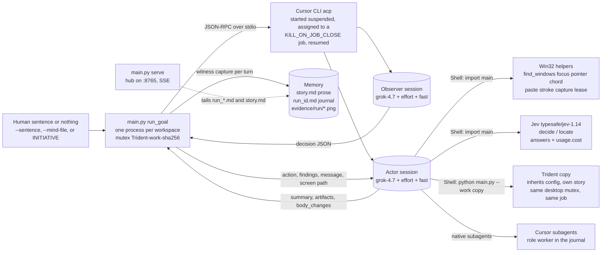
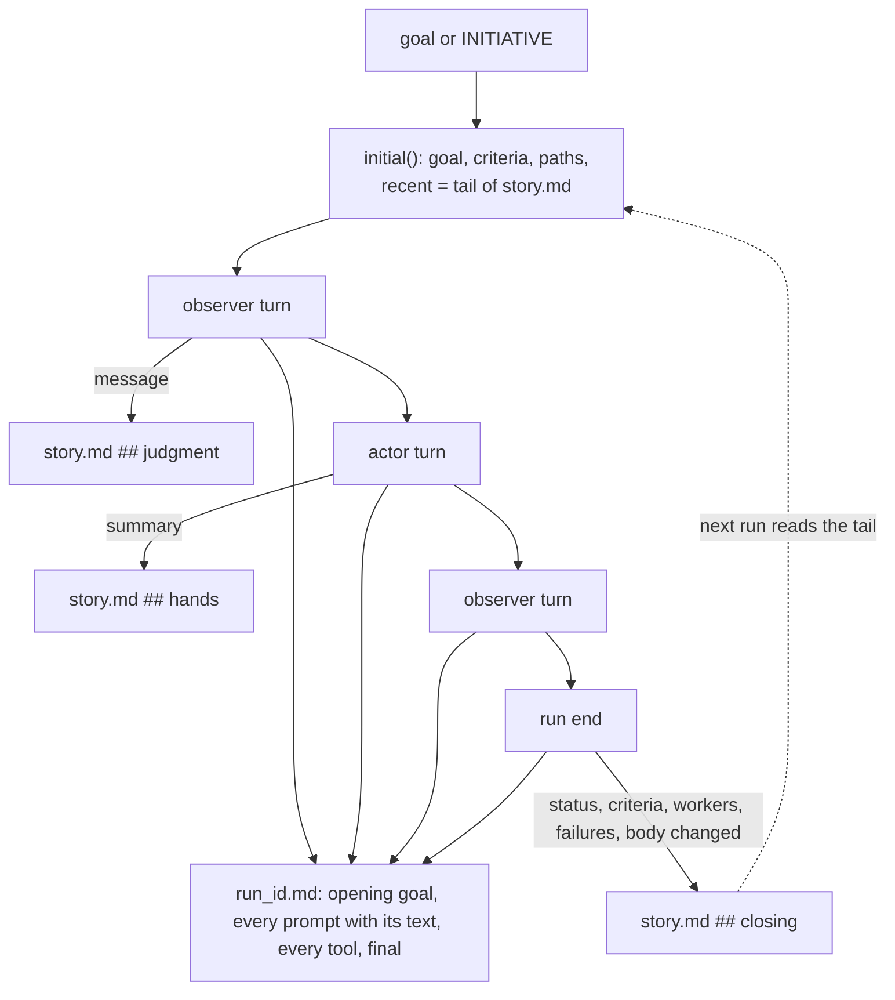
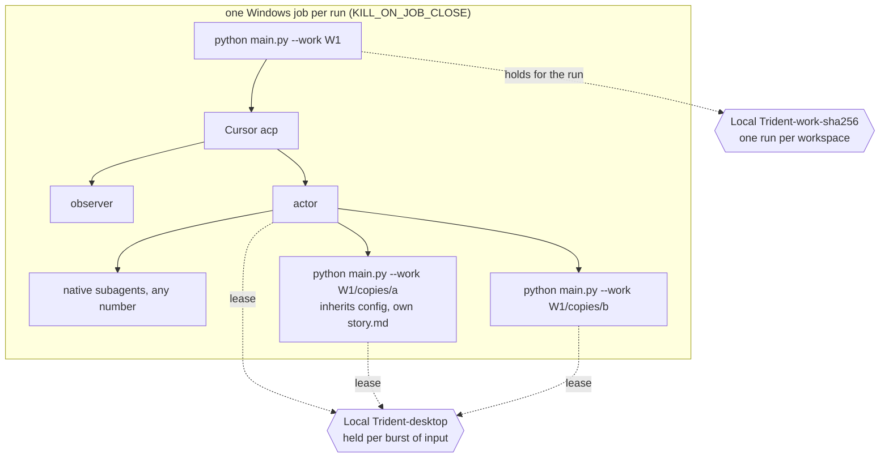

# Trident — a living organism for any computer task

Body: `main.py`, 489 lines, one file, branch `runner-h`. This revision journals a native subagent's reasoning the same way the body already journals that subagent's speech. Body `8406a29` was launched once, run `20261102_110254_6424` on 2026-11-02, and died at 170.3 s with `KeyError: '55ea63fb-4cd1-4863-ab28-a8a50ac045af'` when the first worker emitted `agent_thought_chunk`. The bodies before that are `49d69ed` (the 2026-11-01 job search) and `9ca06de` (the organism rewrite). Written 2026-11-02. This edit has not been launched. The crash numbers are from the `8406a29` run; the 2026-11-01 numbers stay in section 14.

---

## 0. Three plain paragraphs

**What it is.** One Python file turns one human sentence — or no sentence at all — into work on a real Windows computer. It hires the installed Cursor agent as its mind, Jev as its fast cheap judgment and eye, Windows as its hands, and keeps a diary in prose so the next run remembers.

**How it works.** An observer reads the sentence, writes acceptance criteria about the result, judges evidence and narrates. An actor does the work with every installed tool, captures the screen only when it needs to see, holds the desktop only while it clicks, spawns helpers and copies when work is independent, and may edit the body itself. The edit is live on the next run.

**What to expect.** Results judged on inspected artifacts, no invented deadlines or bans, Jev checks before risky clicks, parallel copies when useful, and a growing `story.md`. Not to expect: token or money accounting over Cursor's channel, guarantees against side effects on live accounts, or any run verified before you launch one.

---

## 1. Orientation for an agent with no memory

Read, completely, in this order, before judging anything:

1. This file, end to end.
2. `main.py`, end to end (489 lines; section 4 maps it).
3. `story.md` at the workspace root: the organism's own prose memory across runs, oldest at top, newest at bottom, voices `opening`, `judgment`, `hands`, `closing`.
4. Every `run_*.md` journal, oldest first, including runs that did not finish.
5. Every image under `evidence/<run>/`, in file order, hashing contents to spot duplicates.
6. `agent/config/cli-config.json` (model, account), `agent/config/acp-sessions/*/meta.json` (which Cursor sessions existed; `store.db` are opaque SQLite).
7. `git log --oneline --decorate`, the tag `trident-jobs-cv-2026-11-01` (the body that ran), and commits `85ddd69` and `d426875` (the audit and the first organism README).

There is no `state.json`, `goal.txt`, `stop`, `story.txt`, `ledger.md` or `previous.json`; completion is the exit code and the last `closing` paragraph. Then follow section 16 to audit.

---

## 2. Principles the code embodies

- **One sentence is the assignment, and it is optional.** `--sentence` or `--mind-file` gives a goal; with neither, the body's own `INITIATIVE` sentence (line 16) tells the organism to look around and decide what is worth doing, or do nothing and say why.
- **One file is the body.** Only `main.py`, `README.md` and `HOWTO.md` are tracked; everything else is ignored runtime memory.
- **One model surface.** The Cursor CLI in ACP mode (`agent.ps1 acp`), newline-delimited JSON-RPC over stdio. The model's own tools are the organism's hands.
- **Memory is a story.** `story.md` is append-only prose; nothing on disk is ever rewritten or replaced, so the file race that killed five runs of the first body has no code path.
- **Jev is the fast judgment and the cheap eye.** `typesafe/jev-1.14` answers typed questions (`choice`, `noul`, `score`, `box`) over text and screenshots at $0.042 per million input tokens. Every choice carries the option `change approach`, injected by code, so the organism always has an exit from tunnel vision. `decide` returns Jev's `usage.cost`, so the organism sees what it spends.
- **The eye is on demand.** The controller takes one witness capture after each actor turn for the observer to see. The actor is handed the path and geometry of the latest capture and captures a fresh region itself only when it needs to look.
- **The desktop is shared cooperatively.** A named mutex, held by whoever sends input, only while the input burst lasts.
- **Topology is the organism's decision.** Native subagents and full Trident copies are spawned by the actor when work is independent; nothing fixes their number; a copy inherits this workspace's Cursor configuration at birth.
- **The body you edit is the body of your next run.** Every run is a fresh execution of `main.py`; the run end narrates whether the body's SHA-256 changed.
- **No fallbacks, no retries, no defensive layers.** Unexpected failures raise; expected ends (deadline, blocked, handover) are explicit states with exit codes.
- **A deadline exists only when the human wrote one**, quoted verbatim, with a timezone.

---

## 3. Architecture



Process tree: `python main.py` -> `powershell.exe agent.ps1 acp` -> Cursor's node process -> any Shell the model runs -> `python -c "import main; ..."` helpers, `powershell.exe` captures, and Trident copies. Everything below `python main.py` is one Windows job with `KILL_ON_JOB_CLOSE`; when the run's `ExitStack` closes, the job handle closes and the whole tree ends (`job_object`, lines 143-149; registration in `ACP.__init__`, lines 255-267).

---

## 4. Anatomy of `main.py`

| Lines | Section | Contents |
|---|---|---|
| 1-17 | constants | `BODY`, `ROOT`, `HUB_PORT`, `JEV`, `DECISIONS`, `GROK`, eight `MINDS` slugs, default `MIND`, process flags, hub palette, and `INITIATIVE` (the goal-less sentence) |
| 18-43 | Win32 bindings | `signature()` declares restype/argtypes for 19 user32/kernel32/ntdll calls; `SetProcessDPIAware()` |
| 44-57 | structures | `MOUSEINPUT`, `KEYBDINPUT`, `INPUT`, the two job-limit structures |
| 58-71 | control | `Deadline`, `Blocked`, `check`, `utc`, `remaining`, `virtual_screen` |
| 72-112 | hands | `send`, `pointer`, `chord`, `focus`, `find_windows`, `client_size`, `to_screen`, `stroke` |
| 113-129 | eye and text | `powershell`, `capture(path,end,region)`, `paste(hwnd,text)` |
| 130-149 | cooperation and lifetime | `lease`, `job_object` |
| 150-164 | Jev | `post`, `image_part`, `decide` (returns the full response, adds `change approach`), `locate(path,description,left,top,width,height)` (captures the region itself) |
| 165-172 | memory and mind | `journal`, `choose_mind` |
| 173-193 | prompts as data | `OBSERVER`, `ACTOR`, `CONTRACT` (verbatim in section 11) |
| 194-241 | `Mission` | run identity, files, in-memory `state`, `record`, `narrate`, `artifact`, `observe`, `initialize`, `verify`, `initial` |
| 242-365 | `ACP` | Cursor start with config inheritance, pumps, `rpc`, `notice`, `update` (worker speech is `worker`, worker reasoning is `worker-thought`, lines 311-316), `session`, `prompt`, `cancel` |
| 366-423 | `run_goal` | the loop and the closing narration |
| 424-473 | hub | `PAGE`, `Hub` (GET `/`, `/events`, `/md`), `Feed` (seeds cursors at end, tails `run_*.md` and `story.md`), `FeedServer` |
| 474-489 | `main` | `serve` or a goal run; goal is optional; exit codes |

Metrics at this commit: 489 physical lines, 38,613 bytes, 7,234 AST nodes, 52 functions, 13 classes, 0 comments, 0 docstrings.

---

## 5. One run, step by step

```mermaid
sequenceDiagram
  participant P as main.py
  participant A as Cursor ACP
  participant O as Observer
  participant T as Actor
  P->>P: lease work-sha256 · Mission: run id, run_<id>.md, story.md, evidence/<id>/, opening paragraph
  P->>P: sha256 of the body (before)
  P->>A: start agent.ps1 acp suspended (config inherited if this is a copy) · assign to job · resume · initialize (1)
  P->>A: session/new actor (2) · set_config x3 (3-5) · set_mode agent (6)
  P->>A: session/new observer (7) · set_config x3 (8-10) · set_mode agent (11)
  P->>O: OBSERVER + CONTRACT + initial() + {"initialize":true} (12)
  O-->>P: {"timing":{deadline,source},"criteria":[...]}
  P->>P: validate timing · number criteria c1..cN · capture 0.png (witness)
  loop until complete, blocked or handover(continue=false)
    P->>O: {now, criteria, timing, checks, handover, screen, result, artifacts, tools} + latest witness capture
    O-->>P: {"decision","action","findings","handover","message"}
    P->>P: narrate judgment -> story.md
    alt handover continue=true
      P->>A: session/new for each role in fresh
      P->>P: action = handover.instructions
    end
    alt act
      P->>T: {action, findings, message, handover, screen path} (no image attached)
      T->>T: tools; lease('desktop') per burst; capture / Read / locate on demand; subagents; copies; maybe edits the body
      T-->>P: {"summary","artifacts","body_changes"}
      P->>P: narrate hands -> story.md · capture <step>.png (next witness) · stat artifacts
    end
  end
  P->>P: complete -> verify(): every criterion passed with reason and existing evidence, no pending tools
  P->>P: finally: sha256 (after) · narrate closing -> story.md · record final
```

Observer decisions (`run_goal`, lines 385-397):

```mermaid
stateDiagram-v2
  [*] --> observing: initialize -> timing + criteria
  observing --> acting: act
  observing --> acting: handover continue=true (new session per role in fresh, action = instructions)
  acting --> observing: actor returned; witness capture taken
  observing --> completed: complete and verify() passes
  observing --> blocked: blocked
  observing --> handover: handover continue=false
  observing --> deadline: remaining(end) reaches zero (only if the goal set one)
  acting --> failed: any unexpected exception, re-raised
  completed --> [*]: exit 0
  blocked --> [*]: exit 3
  handover --> [*]: exit 2
  deadline --> [*]: exit 2
```



What each role receives (`ACP.prompt`, lines 345-360):

- First prompt of a session: `ROLE + "\n" + CONTRACT + "\n" + JSON(initial()) + "\n" + JSON(update)`. `initial()` carries `goal, model, started, timing, criteria, sessions, now, python, body, work, memory{story, journal, evidence}, recent` where `recent` is the last 8,000 characters of `story.md`. A session refreshed by handover is new, so it gets this preamble again.
- Observer updates carry `now, criteria, timing, checks, handover, screen` and, after the first act, `result, artifacts, tools` (the compact per-turn list: role, kind, title, status, locations). The latest witness capture is attached as an image.
- Actor updates carry `action, findings, message, handover, screen`. No image is attached; `screen` holds the path and geometry of the latest capture, and the actor captures on demand.
- Every prompt's full text is recorded in the journal as a `prompt` record (`time, role, session, request, bytes, image, text`). The reply must be one JSON object; anything else, or a stop reason other than `end_turn`, ends the run explicitly.
- A native subagent is not a prompted session. `ACP.update` lines 311-316 journal its speech immediately as `worker` and its reasoning immediately as `worker-thought`. Neither chunk is appended to the actor's or the observer's `self.text` or `self.thought`. Line 357 still writes one `actor-thought` or `observer-thought` from the prompted session's own buffer, and line 360 still parses that session's own message as the JSON reply.

---

## 6. Memory

| File | Written by | Form | Purpose |
|---|---|---|---|
| `story.md` (workspace root) | `Mission.narrate` | append-only; `## <UTC> <run> <voice>` then prose; voices `opening` (run, model, goal), `judgment` (observer message), `hands` (actor summary), `closing` (run end) | memory across runs; the tail feeds every new run |
| `run_<id>.md` | `Mission.record` | append-only; `## HH:MM:SS <kind>` then text or JSON | the complete journal of one run |
| `evidence/<id>/0.png`, `<step>.png` | `Mission.observe` | PNG of the whole virtual screen at physical resolution | the witness the controller saw after each turn |
| `evidence/<id>/...` | the actor | its own captures, crops, page text | what the organism chose to keep |
| `agent/config`, `agent/data` | Cursor CLI, inherited on copies | Cursor's own state | `CURSOR_CONFIG_DIR`/`CURSOR_DATA_DIR` per workspace |

Journal record kinds: `opening` is in the story, not the journal; the journal has `goal`, `sessions`, `acceptance`, `prompt` (with full text), `prompt-result` (seconds, raw response), `observer`/`actor` (the JSON reply), `observer-thought`/`actor-thought` (one record per prompted turn, line 357), `tool` (full completed event with raw input/output), `permission`, `plan`, `worker` (a subagent's speech, one chunk at a time), `worker-thought` (a subagent's reasoning, one chunk at a time, lines 314-316), `worker-spawned`, `stderr`, `cancel`, `final` (`status, elapsed_seconds, passed, criteria, failures, workers, action, handover, body_changed`), and any other ACP update by its own name.



---

## 7. The eye

- **Witness capture** (`Mission.observe`, lines 215-219): after each actor turn and once at start, `capture()` writes a PNG of the whole virtual screen; `state['screen']` is `{image, left, top, width, height, observed}` in physical pixels, equal to the PNG size. The observer sees this attached.
- **Actor on demand**: the actor gets the witness path and geometry in `screen` and decides whether to `Read` it, take a fresh `capture(path, region=(left,top,width,height))`, or ask Jev. The controller no longer forces a capture before the actor turn, so file-only work sends no extra screenshot and the model is never handed a picture it did not ask for.
- **Jev** (`decide`, `locate`, lines 155-164):
  - `decide(state, questions)` posts to `https://openrouter.ai/api/alpha/decisions` with the OpenRouter key from `..\.env` and returns the whole response: `answers` (typed, with probabilities and `confidence`), `usage.cost` in USD, and the dated `model`. Question types `choice` (code adds `change approach`), `noul`, `score`, `box`.
  - `locate(path, description, left, top, width, height)` captures that physical region itself, asks a `box` and a `noul` question, and returns `{x, y, present, confidence}` as a physical point. The caller keeps each side within Jev's 256-1568 pixels by choosing the region.
  - If Jev raises (no key, no balance, 4xx/5xx), the error reaches the model through its Shell output and it proceeds another way. No code branch handles Jev availability.

---

## 8. The hands

Importable (`sys.path.insert(0, body_dir); import main`), physical pixels after DPI awareness. The shell is PowerShell, so the contract tells the organism to batch several helper calls into one `python -c`.

| Helper | Contract |
|---|---|
| `find_windows(title_suffix)` | visible top-level HWNDs whose title ends with the suffix |
| `focus(hwnd)` | restore, Alt-tap, `SetForegroundWindow`, verify; raises if not foreground |
| `client_size(hwnd)` | `(width, height)` of the client area |
| `to_screen(hwnd, x, y)` | client pixel to physical point |
| `pointer(x, y, flags)` | absolute mouse event; flags 0 move, 2 left down, 4 left up |
| `chord(*(vk, updown))` | key events; 0 down, 2 up; types keys, not text |
| `paste(hwnd, text)` | any Unicode text via clipboard (base64) then Ctrl+V |
| `stroke(hwnd, points, pause=0.008)` | press, move through points, release; returns the screen path |
| `capture(path, end=None, region=None)` | PNG of the virtual screen or a physical region |
| `lease(name, end=None, wait=False)` | mutex context manager; `wait=True` honors a deadline, `wait=False` raises `Blocked` if held |
| `decide`, `locate`, `image_part`, `virtual_screen`, `powershell`, `post` | section 7 |

`SendInput` success means Windows accepted the event, not that the application reacted; inspect after input.

---

## 9. Topology and cooperation



- **Workspace mutex** (`run_goal`, line 368): two runs cannot share a `--work`; the second fails `Blocked` (exit 3).
- **Desktop mutex**: not held by the controller. The actor wraps each input burst in `with main.lease('desktop', wait=True):`; copies and subagents do the same, so one physical desktop is shared while file, web and Jev work run in parallel.
- **Copies**: `python <body> --work <new dir> --model <slug> --sentence <subgoal>`. On start a copy inherits this workspace's `agent/config` (minus `acp-sessions` and the statsig cache) via `shutil.copytree` (`ACP.__init__`, lines 247-249), so it is logged in; it has its own `story.md`, journal and evidence, shares the desktop and account, and dies with the parent's job unless detached. The actor collects child results before finishing.
- **Subagents**: Cursor-native. `subagent_spawned` stores the child id as role `worker` and records `worker-spawned` (lines 330-333). Speech chunks are `worker`; reasoning chunks are `worker-thought` (lines 311-316). `state['workers']` counts them into the closing paragraph. The actor prompt stays open, and line 360 still parses only the actor's JSON.
- **Model**: both sessions get `model=grok-4.7`, `reasoning_effort` and `fast` from the slug; copies are told to inherit the parent's slug.

---

## 10. Self-modification

The contract states it once: the body you edit is `main.py`, and the body you edit is the body of your next run. No hot reload, nothing to reason about — every launch executes the file as it is on disk. Two rules shape edits: edit when a limitation is demonstrated; when the actor writes the same helper twice it adds one generic function to the body — real arguments, return values, raised errors, no task words — and names it in `body_changes`. The controller hashes the body at start and end (`run_goal`, lines 370 and 416) and the closing paragraph says whether it changed; `final` carries `body_changed`. Judge an edit by its effect on later runs, not by its existence.

---

## 11. Prompts (verbatim, lines 173-193)

OBSERVER
```
You are Trident's observer, the judgment of a living organism that works on this computer. The human sentence is the only assignment. Today's date and current facts come from the system clock and the internet, never from memory. On the first turn return only {"timing":{"deadline":null,"source":null},"criteria":["..."]}: a deadline exists only when the human wrote one, as an ISO timestamp with timezone plus the verbatim quote in source; criteria describe the result the human will hold, never procedure, tools, reading or timing. On every later turn you are shown the latest screen capture and the actor's tools and artifacts; inspect real evidence yourself and return {"decision":"act","action":"the next useful work","findings":{"c1":{"passed":false,"evidence":["path"],"reason":"what the evidence shows"}},"handover":null,"message":"prose"}. Decisions are act, complete, blocked or handover. Findings carry only criteria whose status changed; a file, a green command or a confident summary is not evidence until you inspected its content. Complete only when every criterion is supported by inspected artifacts. Your message is the organism's memory: plain prose on what was tried, what was seen, what was learned and what comes next, appended to story.md and read by future runs. Add no restriction, budget, deadline or ban the human did not write; prefer the bolder useful action, parallel work and fresh routes over repeating one. Handover is {"continue":true,"fresh":["actor"],"instructions":"what to carry on"}: each role named in fresh gets a new empty context before the work continues, so use it to clear a tangled actor or your own context; continue false ends the run for a human to take over.
```

ACTOR
```
You are Trident's actor, the hands and eyes of a living organism that works on this computer. Carry the current action as far as it usefully goes in one turn, observing results between dependent steps and changing method when results warrant. Research the internet by default and take current facts from it. Spawn native subagents or Trident copies whenever work is independent and decide their number yourself. Hold the desktop only while you send input. screen gives the path and geometry of the most recent capture; Read it or capture a fresh region yourself when you need to see, and before a side-effect click locate the target with Jev and look. After input, inspect the effect. Return {"summary":"what actually happened, including failures, unfinished work and the real IDs and paths of workers and copies","artifacts":["existing output paths"],"body_changes":["each generic helper or prompt sentence you added to the body, or empty"]}.
```

CONTRACT
```
Return one JSON object without Markdown. You have every installed tool of this computer and the owner's standing authorization for research, files, applications, Chrome, images, shell and code; availability is proven by use, not assumed. The body is the file at body; your shell is PowerShell, so to use its helpers run one python -c that adds the body's directory to sys.path, imports main, and makes several calls at once rather than one process per call. The body you edit is the body of your next run: edit it when a limitation is demonstrated, and when you write the same helper twice make it one generic function in the body with real arguments, return values and raised errors and no task words, then name it in body_changes. Helpers: find_windows(title_suffix)->HWND list; focus(hwnd); client_size(hwnd)->(width,height); to_screen(hwnd,x,y)->physical point from client pixels; pointer(x,y,flags) in physical pixels, flags 0 move 2 left down 4 left up; chord(*(vk,0 down or 2 up)) types keys, not text; paste(hwnd,text) puts text on the clipboard and presses Ctrl+V in that window, for any text including Polish letters; stroke(hwnd,points,pause=0.008)->screen points; capture(path,end=None,region=None)->PNG of the whole virtual screen, or of region (left,top,width,height) in physical pixels; virtual_screen()->(left,top,width,height); lease('desktop',wait=True) is a context manager, hold it for each burst of input and release it after; decide(state,questions)->the Jev typesafe/jev-1.14 response, with answers (typed, with probabilities, over text and PNG image parts from image_part(path), question types choice, noul, score and box, every choice given the option change approach) and usage.cost; locate(path,description,left,top,width,height) captures that physical region, asks Jev, and returns {x,y,present,confidence} in physical pixels, so keep each side between 256 and 1568 pixels. If Jev raises, read the error and proceed another way. Jev is fast and cheap: use it before side-effect clicks, to verify screens and artifacts, to choose between routes and to test your own criteria. Do not repeat a tool or route because it worked once; vary source and method. Copies: python body --work new_dir --model your_model --sentence subgoal; a copy inherits this workspace's Cursor configuration, owns its own workspace and story, shares the desktop mutex and the account, and dies with this run's job unless detached; collect child results before you finish. Memory: story.md is append-only prose shared by every run in this workspace, run_*.md is this run's journal, evidence/<run>/ holds captures. SendInput does not prove application effect; inspect.
```

INITIATIVE (line 16, the goal when none is given)
```
No concrete goal was given this time. Read your story.md and recent journals, look at this computer, and take the current date and anything time-sensitive from the internet. Decide what is genuinely useful for the owner now and do it when it is clearly useful and reversible, otherwise do nothing and record one honest paragraph on why. You decide when the work is done.
```

The only hard rules are the JSON shapes and "add no restriction the human did not write". Everything else is authorization and description. The wording avoids imperative phrases that provider safety layers refuse.

---

## 12. Launching

Prerequisites: Python 3.11, the Cursor CLI at `%LOCALAPPDATA%\cursor-agent\agent.ps1` authenticated, an OpenRouter key as the whole content of `..\.env` relative to the body (for Jev), an unlocked desktop.

```powershell
# a goal in the body's workspace, default mind grok-4.7-medium-fast
& '<python>' -B -u -X utf8 '<Trident>\main.py' --work '<Trident>' --sentence '<goal>'

# a goal from a file, and an explicit mind
& '<python>' -B -u -X utf8 '<Trident>\main.py' --work '<Trident>' --model grok-4.7-xhigh-fast --mind-file '<Trident>\task.txt'

# no goal: the organism reads its story and decides (INITIATIVE)
& '<python>' -B -u -X utf8 '<Trident>\main.py' --work '<Trident>' --model grok-4.7-xhigh-fast

# the viewer, another terminal: http://127.0.0.1:8765/ (live) or /md (all relayed so far)
& '<python>' -B -u -X utf8 '<Trident>\main.py' serve

# a copy the organism itself may launch
& '<python>' -B -u -X utf8 '<Trident>\main.py' --work '<Trident>\copies\<name>' --model <slug> --sentence '<subgoal>'
```

- `--model` must be one of `grok-4.7-{low,medium,high,xhigh}[-fast]`; otherwise a slug inside the goal; otherwise `grok-4.7-medium-fast` (`choose_mind`, lines 168-172).
- `--run` names the journal and evidence directory; omit it for `YYYYMMDD_HHMMSS_<pid>`. An existing evidence directory is an error, never reused.
- Exit codes (`main`, line 485): 0 completed, 2 deadline or handover ended, 3 blocked (including a busy workspace), 1 unhandled error or Ctrl+C. Read `$LASTEXITCODE` right after.
- The foreground terminal prints the journal. The hub follows `run_*.md` and `story.md` in the body's directory and, since this revision, relays only content written after it starts.
- Inspect results from `story.md`'s last `closing` paragraph, the journal's `final` record, and the artifacts.

---

## 13. Writing a goal

```
I am <owner name>, the owner of this computer and of the accounts logged in on it. Today's date and all current facts must be taken from the system clock and the internet. Use everything installed here - shell, files, Chrome, the screen, the clipboard, Jev, native subagents and Trident copies - and decide yourself how to split the work.

[GOAL]

Judge the real result against this sentence, not against effort. Report what exists with paths and source links, what was verified and how, and what remains unknown or unfinished. Make no success claim without inspected evidence. If you built a generic tool on the way, keep it in main.py and say so.
```

Add a timing sentence only when it is real ("Finish within 35 minutes from this run start."); the observer must quote it verbatim or no deadline exists. Give no goal at all to let the organism decide (INITIATIVE).

---

## 14. Lineage: the gaps this revision closes

The full audit of the first body (`49d69ed`, tag `trident-jobs-cv-2026-11-01`) is in commit `85ddd69`; the first organism rewrite is `9ca06de`/`d426875`; the organism that closed that review is `8406a29`. Measured facts from the six 2026-11-01 runs of the first body: runs 1-5 died within about a minute each with `PermissionError` while the controller atomically replaced its state file during a model tool call; run 6 completed in 1,350.2 s on `grok-4.7-medium-fast`, 1,333.5 s of it inside 6 ACP round trips (98.8 %), 154 tools, 0 workers, 0 copies, 0 body edits, 90,383 B of controller text, 7.49 MB of PNG, zero token records.

Body `8406a29` ran once: `20261102_110254_6424`, `grok-4.7-xhigh-fast`, started 2026-11-02T10:02:54Z, failed at 170.3 s, exit 1. One worker (`55ea63fb-4cd1-4863-ab28-a8a50ac045af`) was spawned at 11:05:42 local. The next `agent_thought_chunk` on that session raised `KeyError` because line 314 of that body always did `self.thought[session] += text`, and only `ACP.session` created those keys. `story.md` has `opening`, one `judgment`, and `closing`, and no `hands` paragraph. Passed criterion `c4` only. `body_changed` is false. The `cancel` record at the same timestamp is the `ExitStack` cancelling the still-open actor session `c9ebf9b7-36ac-4545-9198-77e60db512b4`. Stdout, including the traceback, is `Windows PowerShell.txt`. The journal is `run_20261102_110254_6424.md`. Both are gitignored.

```mermaid
gantt
  title First body, run 20261101_173529_9512 - measured (UTC)
  dateFormat HH:mm:ss
  axisFormat %H:%M
  section Observer
  init 13.5 s                     :16:35:40, 16:35:53
  decide 1 73.4 s                 :16:35:53, 16:37:07
  decide 2 47.6 s                 :16:50:58, 16:51:45
  decide 3 complete 47.0 s        :16:57:12, 16:57:59
  section Actor (desktop held whole turn)
  action 1 jobs 828 s             :16:37:08, 16:50:56
  action 2 profile CVs 324 s      :16:51:47, 16:57:10
```



| Gap observed | Correction in this body |
|---|---|
| 56 interpreter spawns, one `python -c` per helper call | CONTRACT names PowerShell and the batch pattern: one `python -c` per burst, many calls inside (section 8) |
| two full screenshots to Grok every cycle; file work forced a capture | controller takes one witness after each actor turn; the actor gets a path and captures on demand (section 7) |
| observer session could never be refreshed; handover only resumed or refreshed the actor | handover `{continue, fresh, instructions}` opens a new session per named role; the observer update carries criteria, timing, checks and handover so a fresh observer is whole (sections 5, 11) |
| no way to start without a goal | optional `--sentence`; `INITIATIVE` drives a goal-less run (sections 2, 11, 12) |
| copies in a fresh `--work` might not be authenticated | a copy inherits `agent/config` via `shutil.copytree` at start (section 9) |
| Jev cost invisible | `decide` returns `usage.cost`; the organism sees its spend (section 7) |
| `locate` needed a pre-made capture and could exceed Jev's size limit | `locate` captures its own region within 256-1568 px (section 7) |
| redundant memory files; completion signalled by a `stop` file | `goal.txt`, `stop`, `state.json`, `story.txt`, `ledger.md` gone; `story.md` opening and closing plus the exit code carry it (sections 1, 6) |
| the last run kept only one prompt text | every prompt's full text is journaled (section 5) |
| the hub replayed every old journal on start | `Feed` seeds cursors at the current file end (section 12) |
| a worker's `agent_thought_chunk` indexed `self.thought` for a session `ACP.session` never created, so the first subagent thought killed run `20261102_110254_6424` | `update` journals worker reasoning immediately as `worker-thought` (lines 314-316), the same way worker speech is already journaled as `worker` (lines 311-313). Actor and observer reasoning still accumulate and flush once per prompt (line 357) |

---

## 15. Standing rules for anyone who edits this body

1. The human goal is the assignment. Invent no budget, closing window, lesson, retry or success claim. A deadline exists only when the human supplied one.
2. Only `main.py` changes; no new source files, dependencies, SDKs, harnesses, fallback runtimes, JSON repair, exception suppression or guard frameworks. Unexpected failures stay explicit.
3. Preserve execution semantics: protocol parsing, real results and errors, deadline arithmetic, resource cleanup, process and child lifetime through the job, workspace ownership, cooperative desktop input.
4. No Python comments or docstrings; prompt text and factual contracts are data; rename confusing names and update every consumer together.
5. Internet research and current facts by default; the organism decides its own topology; discovered tools become generic body functions.
6. Review before changing: report first, propose, then edit. During review use static inspection only (AST parse, in-memory compile without import, tokenizer, Git diff); do not launch Trident, the hub or a paid goal; document what stays unverified.
7. Commit only `main.py`, `README.md`, `HOWTO.md` on `runner-h`; push normally; never force-push. `main` and the tag `trident-jobs-cv-2026-11-01` mark the first body.

---

## 16. How to audit a run of this body

Default to read-only forensic review and an actionable plan; write the report before touching source.

**Inventory and coverage.** Record date and timezone, workspace, branch, revision, dirty changes, and the body's lines, bytes, AST nodes, functions and classes. Manifest: source; every prompt and contract (section 11 plus anything added); `cli-config.json`; `story.md`; every `run_*.md`; every image with content hashes; `acp-sessions/*/meta.json`; artifacts the actor wrote. Mark each READ, STRUCT, PART, VIEWED or OPAQUE (`store.db`). Never replace full reading with undisclosed sampling; if coverage cannot be completed, name the gap and what it prevents.

**Reconstruct every run** from its journal and story: the sentence (or INITIATIVE); the declared timing and its verbatim quote; model and the runtime config Cursor returned; sessions, including any refreshed by handover; each prompt's bytes, full text and round-trip seconds; each observer decision and actor summary; every tool with role, kind, title, status, locations; permissions; workers and copies with real IDs; captures; artifacts with sizes; `body_changed` and `body_changes`; interruptions; the `final` record and the `closing` paragraph. Separate what the human asked from what the system declared, and inspect the deliverables yourself.

**Evidence discipline.** Each material finding: a file and line or a timestamp, a short verbatim quote, and corroboration from an independent class (code plus behavior, a tool result plus the artifact, an image plus the text about it). Two logs of one event are one observation. Mark SINGLE-SOURCE when corroboration is absent. Separate observed facts, symptoms, root causes and inferences; trace each why to an exact line or prompt sentence; say where causality breaks. Per finding: ID and human impact; OBSERVED with quote and location; corroboration; why chain; ROOT CAUSE or explicit break; INFERRED interpretation and confidence; measured magnitude or unknown; proposed deletion or reuse; expected after and how later evidence would establish it.

**Five perspectives.** Systems/runtime: job and process lifetime, mutex scope and contention, deadline arithmetic, stream framing, permission handling, capture geometry versus the model's coordinates, append-only memory, interruption and partial effects, hub relay, config inheritance for copies. Prompt engineering: every sentence of OBSERVER, ACTOR, CONTRACT and INITIATIVE against the code; contradictions, false capability beliefs, scarcity or urgency, stale anchoring, forced serialization, procedural criteria, excessive verification, schema pressure; prove a misreading with the model's words and its action. Behavioral: from quotes only, call rationing, loss aversion, stale-plan anchoring, rumination, helplessness, tool avoidance, confabulated progress, and also effective adaptation, exploration and real partial success; NOT ESTABLISHED when evidence is absent; long elapsed time alone proves nothing. Economics: census prompt starts and results, tool actions, sessions, workers, copies, runs; keep bytes, tokens, images, round-trip seconds, inference time, listed rates and invoices separate; Cursor's ACP reports no tokens, so Grok cost is unknown unless another source exists; Jev's `usage.cost` is in the journal if the organism recorded it; concurrent durations do not sum to wall time. Evolution/memory: stored versus recalled versus learned; an edit versus activated behavior versus beneficial capability; whether `story.md` paragraphs informed the next run; whether generic tools were created and helped a different task.

**Judge against the human goal**: perception (did it look before acting, did Jev or its eye catch what mattered), action (useful size and order), coordination (desktop shared per burst, work spawned when independent), judgment (criteria about results, completion on inspected evidence), learning (what the next run knows and has). Do not impose a planner, executor or router; evaluate the organism on its own design.

**External research.** Identify the actual provider, client and model names and the configuration Cursor returned, then read current primary docs and pricing (Cursor ACP, xAI Grok 4.7 and the Cursor-only Fast variant, OpenRouter Jev 1.14) plus clearly labeled community reports; record dates and links; product capability does not prove local access or skill.

**Deliverables.** Three natural-language paragraphs of at most 280 characters each (what happened; what would change behavior; what can and cannot be expected), then the coverage manifest, the chronology, the five perspectives, quantified economics with unknowns named, the evidence register, source-only and unresolved findings, measured versus predicted timelines clearly labeled, and a plan where each change states the observed before, the exact cause, the concrete edit, the expected after, confidence, task-agnostic implications, retained capability and the evidence still needed. Prefer deletion and reuse; count physical lines and a structural metric so layout compression cannot pose as simplification. Unknown means unknown; confidence is an evidence judgment, never 100 on demand.

---

## 17. Verification state

Static only, 2026-11-02, for this commit: `ast.parse` ok; in-memory `compile()` without import ok; tokenizer ok; 489 physical lines, 38,613 LF bytes, 7,234 AST nodes, 52 functions, 13 classes; 0 comments, 0 docstrings; LF, no trailing whitespace. Worker reasoning is lines 314-316. Actor and observer reasoning still use `self.thought[session] += ...` and still flush at line 357.

Launched before this edit, not after it: body `8406a29`, run `20261102_110254_6424`, died on the missing worker rule. This edit has not been launched. A run of this body that spawns a subagent should record `worker-thought` and then return the actor's JSON, so `story.md` gains a `hands` paragraph. Still unchecked on this edit: no `*.tmp` and no `PermissionError`; one witness capture per cycle (`0.png`, `1.png`, ...) with no `-before.png`; Jev calls as `execute` tools importing `main` and calling `decide` or `locate`, with `change approach` in any choice question and `usage.cost` in the result; a goal-less run adopting INITIATIVE; and, for a copy, whether the inherited `agent/config` actually authenticates Cursor in a fresh `--work`. If another primitive misbehaves, the proven reference for the 2026-11-01 hands is the tag `trident-jobs-cv-2026-11-01`.

---

## 18. External references (retrieved 2026-11-02)

- Cursor CLI ACP: https://cursor.com/docs/cli/acp
- Cursor ACP reports no token usage: https://forum.cursor.com/t/cursor-acp-doesn-t-seem-to-return-token-usage-in-promptresponse-usage/160395 and https://forum.cursor.com/t/cursor-agent-acp-never-reports-token-usage-over-acp-though-p-output-format-json-does/171923
- xAI Grok 4.7 pricing (2026-10-10): https://docs.x.ai/developers/pricing — standard $2 / $0.50 cached / $6 per 1M; the Fast variant is Cursor and Grok Build only at 2x, billed through the Cursor plan
- Jev on OpenRouter: https://openrouter.ai/docs/guides/community/jev, https://openrouter.ai/typesafe/jev-1.14 ($0.042 per 1M input, output free, 262k context, released 2026-10-14), https://openrouter.ai/docs/guides/community/multimodal-decisions (image parts 256-1568 px per side, Box answers), https://openrouter.ai/docs/api/api-reference/alphadecisions/submit-a-decisions-request (response has answers and usage.cost)
